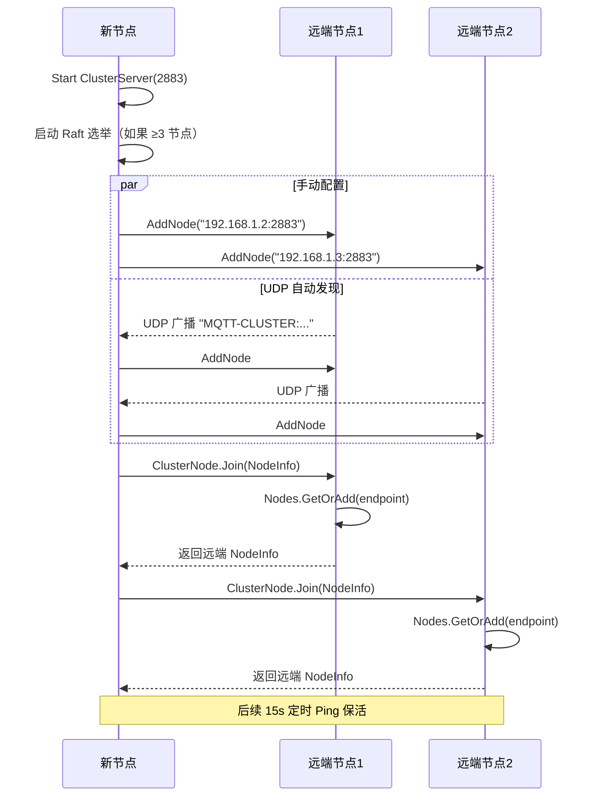
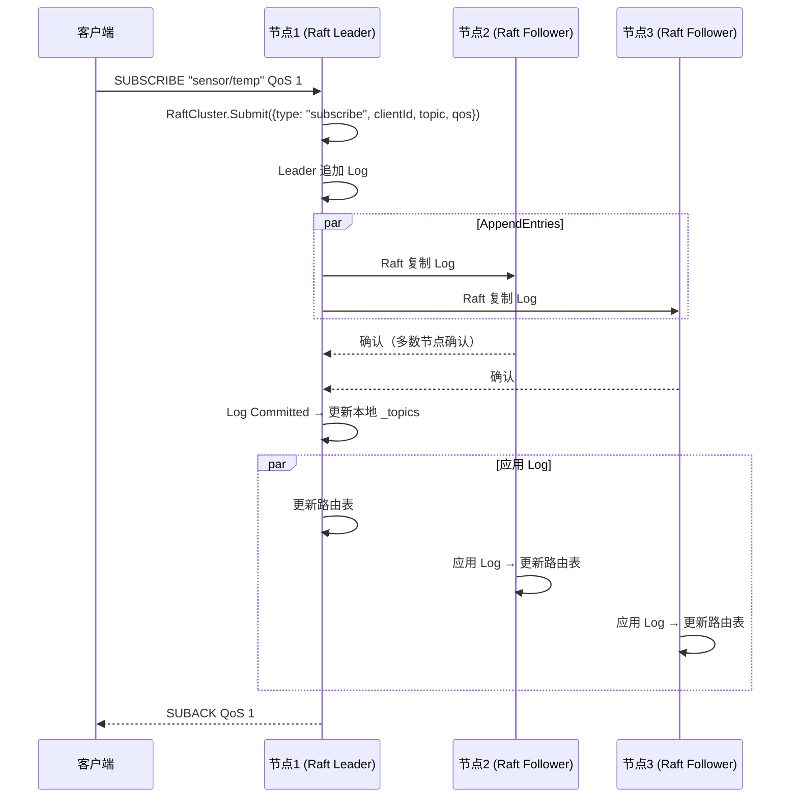
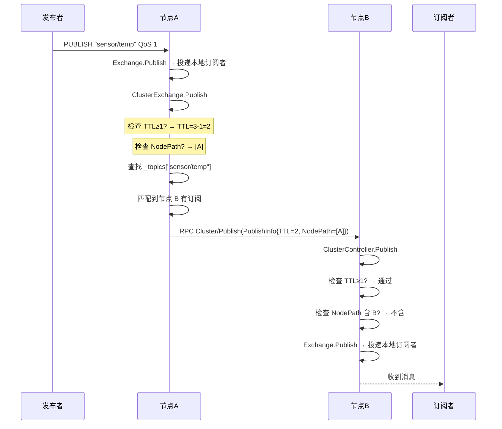
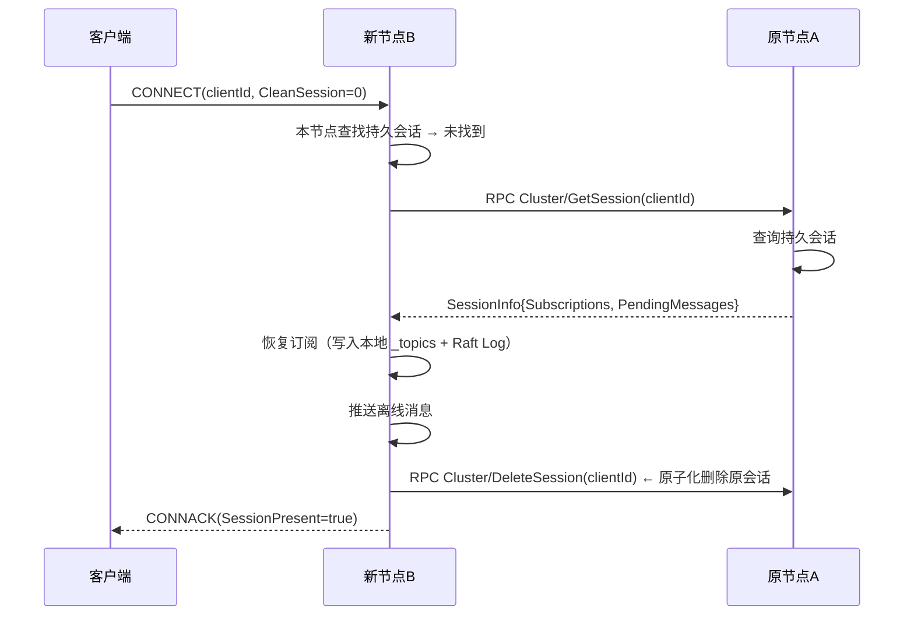
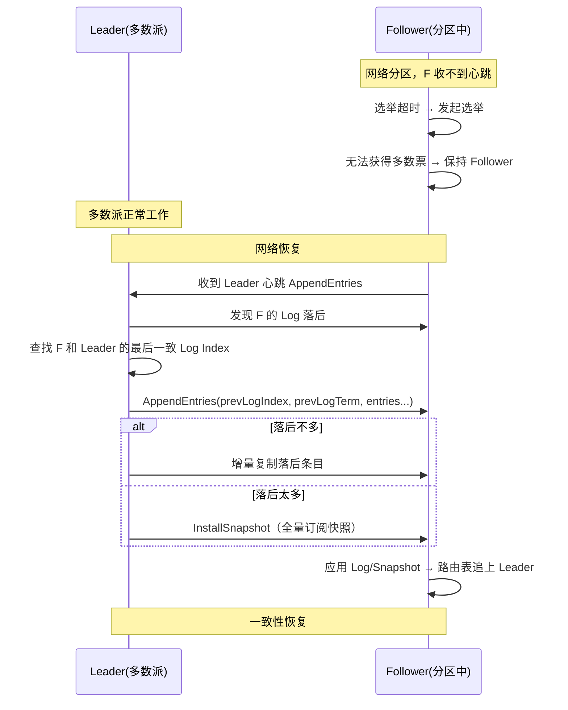
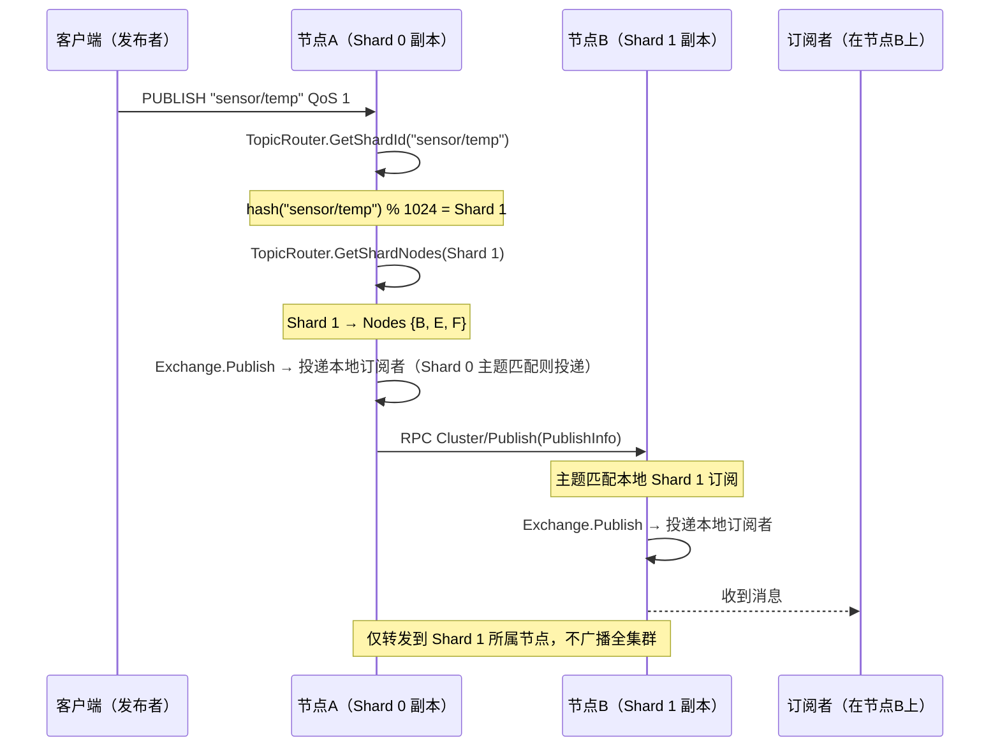
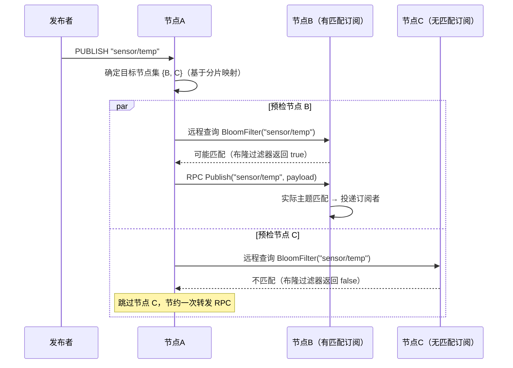
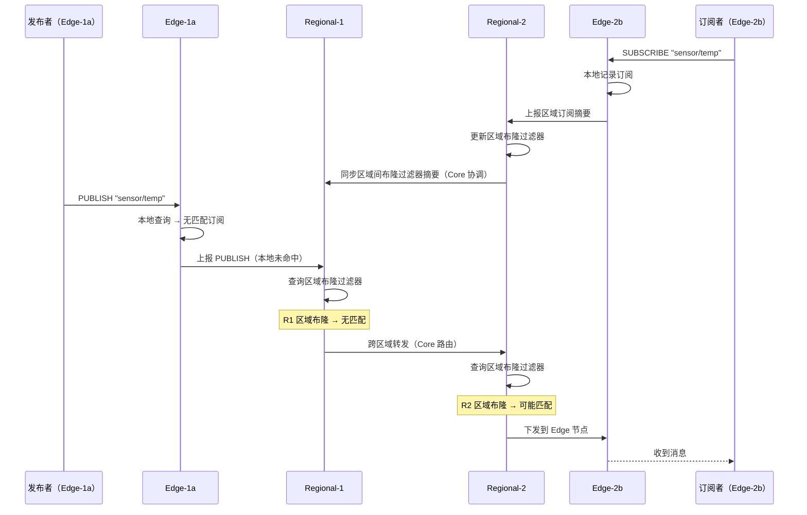

# M6 集群架构

> 版本：v5.0 | 日期：2026-07-15
> 需求对应：[需求文档](需求文档.md) §3.6 | 功能清单：[功能清单](功能清单.md) M6 | 返回：[架构设计](架构设计.md)

## 1. 整体架构

### 1.1 当前实现（v3.x 现状）

当前集群是一个 RPC 广播式集群，内置于 `NewLife.MQTT/Clusters/` 目录：

```
  Node A ──RPC──► Node B     通信方式：ApiServer/ApiClient（独立端口 2883）
    │               │         订阅同步：RPC 广播（foreach 遍历）
    └───RPC──► Node C        消息转发：主题过滤器匹配后 RPC 转发
                             节点发现：UDP 广播 (ClusterDiscovery)
```

**当前已实现（代码中真实存在）**：`ClusterServer.cs`、`ClusterNode.cs`、`ClusterController.cs`、`ClusterExchange.cs`、`ClusterDiscovery.cs` 及 4 个数据模型。

### 1.2 演进路线

集群架构按规模分阶段演进，每个阶段在上一阶段基础上叠加新能力：

| 阶段 | 规模 | 架构模式 | 核心能力 | 代号 |
|:----:|:----:|:---------|----------|:----:|
| **v3.x** | 3~20 节点 / 百万级设备 | RPC 全连接广播 | 节点管理、订阅同步、消息转发 | ✅ 已实现 |
| **v4.x** | 10~50 节点 / 千万级设备 | Raft 共识 + 环路检测 | 订阅强一致、TTL+NodePath 环路防护、ClusterSecret | ✅ 已实现 |
| **v5.x** | 50~1000 节点 / 亿级设备 | **主题分片 + 定向路由** | 一致哈希分片、布隆过滤器预检、热点自适应复制 | 🔮 本阶段新增 |
| **v6.x** | 1000~10000+ 节点 / 百亿级设备 | **多层分级路由** | Edge → Regional → Core 三级拓扑、连接聚合、区域自治 | 🔮 未来规划 |

#### v4.x 架构（✅ 已实现）

新增 Raft 共识（订阅强一致）+ 环路检测 + 共享密钥：

```
              Raft Group（订阅关系强一致）
             ┌──────────────────────────┐
             │ Leader ── Log ──► Node 2 │
             │   └────── Log ──► Node 3 │
             └──────────────────────────┘
                        │
            消息转发走直连（最终一致）
           Node 1 ◄──────► Node 2
             └──────────────► Node 3
```

**需新增**：
- 🔧 `Clusters/GossipExchange.cs` — Gossip 可选模式

**已实现**：`ClusterExchange.cs`（Raft Log + 环路检测）、`ClusterController.cs`（ClusterSecret）、`PublishInfo.cs`（TTL+NodePath）

#### v5.x 架构（主题分片）

在 v4.x 基础上增加主题分片路由层，从「全量复制」转向「分片定向」：

```
                    ┌─────────────────────┐
                    │  一致哈希环           │
                    │  Shard 0 → Node{A,B,C}│
                    │  Shard 1 → Node{D,E,F}│
                    │  Shard 2 → Node{G,H,I}│
                    │  ...                 │
                    └─────────────────────┘
                             │
        ┌────────────────────┼────────────────────┐
        │                    │                    │
   ┌────▼────┐         ┌────▼────┐         ┌────▼────┐
   │ Node A  │         │ Node D  │         │ Node G  │
   │ Shard 0 │◄───────►│ Shard 1 │◄───────►│ Shard 2 │
   │ (Leader)│         │ (Leader)│         │ (Leader)│
   └────┬────┘         └────┬────┘         └────┬────┘
        │                   │                   │
   ┌────▼────┐         ┌────▼────┐         ┌────▼────┐
   │ Node B  │         │ Node E  │         │ Node H  │
   │ Shard 0 │         │ Shard 1 │         │ Shard 2 │
   │(Follower)│        │(Follower)│        │(Follower)│
   └─────────┘         └─────────┘         └─────────┘
```

**特点**：
- 每个节点仅持有少数分片的订阅数据（约 total_subscriptions / shard_count）
- 消息仅转发到目标分片所属节点子集，而非全集群
- 节点加入/离开仅影响相邻分片（虚拟节点平滑迁移）
- 分片内部用 Raft 或 Gossip 维持副本一致性

#### v6.x 架构（多层分级）

在 v5.x 基础上增加多层分级路由，支撑百亿级设备：

```
         Core 层（全局路由协调）
    ┌──────┴──────┐
    │  Core Node  │─── Bloom Filter: 区域订阅摘要
    └──────┬──────┘
           │
    ┌──────┴──────┐         ┌──────┴──────┐
    │ Regional-1  │◄───────►│ Regional-2  │  区域层
    └──────┬──────┘         └──────┬──────┘
           │                       │
    ┌──────┴──────┐         ┌──────┴──────┐
    │Edge-1a│Edge-1b│       │Edge-2a│Edge-2b│  边缘层
    │ 设备池      │       │ 设备池      │
    └─────────────┘       └─────────────┘
```

**特点**：
- Edge 节点：连接聚合，本地订阅 + 热分片缓存
- Regional 节点：区域内路由，区域主题摘要
- Core 节点：跨区域路由，全局布隆过滤器

### 1.3 项目结构

```
NewLife.MQTT/                  # 核心库（集群内置，零额外依赖）
  └── Clusters/                # 全部集群代码
       ├── ClusterServer.cs       # ✅ 已实现 — 节点管理
       ├── ClusterNode.cs         # ✅ 已实现 — 远程节点 RPC 通信
       ├── ClusterController.cs   # ✅ 已实现 — RPC 处理
       ├── ClusterExchange.cs     # ✅ 已实现 — 订阅路由 + 消息转发
       ├── ClusterDiscovery.cs    # ✅ 已实现 — UDP 自动发现
       ├── RaftCluster.cs         # ✅ 已实现 — Raft 共识引擎
       ├── GossipExchange.cs      # 🔧 重构 — Gossip 传播（可选）
       ├── TopicShardManager.cs   # 🔮 新增 — 主题分片（一致哈希）
       ├── TopicRouter.cs         # 🔮 新增 — 分片感知路由表
       ├── BloomFilterExchange.cs # 🔮 新增 — 布隆过滤器订阅同步
       ├── HierarchicalCluster.cs # 🔮 新增 — 多层集群拓扑管理
       ├── HotTopicDetector.cs    # 🔮 新增 — 热点主题检测与自适应复制
       └── BatchForwardPipe.cs    # 🔮 新增 — 批量合并转发管道

NewLife.MQTT.Storage/          # ✅ 新项目（持久化扩展）
  依赖: NewLife.MQTT + NewLife.XCode + NewLife.Redis
```

### 1.4 分层职责

| 层次 | 组件 | 状态 | 职责 |
|------|------|:----:|------|
| **共识层** | `RaftCluster` | ✅ | 订阅元数据的 Raft 共识（Leader 选举、Log 复制、Snapshot） |
| **传播层** | `GossipExchange` | 🔧 | 节点间 Gossip 传播（可选，大规模场景） |
| **分片层** | `TopicShardManager` / `TopicRouter` | 🔮 | 主题一致哈希分片 + 分片感知路由（v5.x 核心） |
| **加速层** | `BloomFilterExchange` / `HotTopicDetector` | 🔮 | 布隆过滤器预检 + 热点检测与动态副本调整 |
| **管理层** | `ClusterServer` / `ClusterNode` | ✅ | 节点 Join/Ping/Leave、超时剔除 |
| **拓扑层** | `HierarchicalCluster` | 🔮 | 多层分级拓扑（Edge/Regional/Core） |
| **发现层** | `ClusterDiscovery` | ✅ | UDP 广播 / SPI 自动发现 |
| **路由层** | `ClusterExchange` | ✅ | 订阅关系映射 + 跨节点消息转发 |
| **优化层** | `BatchForwardPipe` | 🔮 | 批量合并转发管道 |
| **存储层** | `MqttStorageExchange` | ✅ | Redis / Database 持久化（Storage 项目） |

### 1.5 依赖关系

```
MqttServer
  └── ClusterServer
        ├── RaftCluster              ← Raft 共识引擎
        ├── ClusterExchange          ← 路由转发（持有 _topics 字典）
        │     └── TopicShardManager  ← 主题分片决策
        │     └── TopicRouter        ← 分片→节点映射
        │     └── BloomFilterExchange ← 布隆过滤器预检
        │     └── HotTopicDetector   ← 热点检测与副本调整
        ├── HierarchicalCluster      ← 多层拓扑管理（可选）
        ├── BatchForwardPipe         ← 批量合并转发（可选）
        ├── ClusterNode[]            ← 节点连接池
        ├── ClusterController        ← RPC 处理
        └── ClusterDiscovery         ← 自动发现
              └── IClusterDiscoveryProvider ← SPI
```

---

## 2. 核心组件设计

### 2.1 RaftCluster — Raft 共识引擎 ✅（已实现）

| 属性 | 说明 |
|------|------|
| 所在工程 | `NewLife.MQTT` |
| 文件名 | `Clusters/RaftCluster.cs`（✅ 已实现） |
| 职责 | 管理 Raft 节点状态机、Leader 选举、Log 复制、Snapshot |

**关键设计决策：**

| 决策 | 选择 | 理由 |
|------|------|------|
| Raft 范围 | 仅订阅元数据 | 消息不过 Leader 保吞吐 |
| Log 条目 | 订阅变更日志（Subscribe/Unsubscribe） | 低频、语义明确 |
| Snapshot | 全量订阅快照 | 节点重启快速恢复 |
| 选举超时 | 150~300ms 随机 | 避免选举分裂 |
| 最小节点 | 3（Raft）/ 1（降级） | Raft 需多数派 |

### 2.2 ClusterExchange — 集群交换机 ✅（当前已实现）

| 属性 | 说明 |
|------|------|
| 所在工程 | `NewLife.MQTT` |
| 文件名 | `Clusters/ClusterExchange.cs`（✅ 已存在） |
| 职责 | 维护远程订阅关系 `_topics` 字典、跨节点消息转发（重构后增加环路检测） |

**`_topics` 字典结构：**

```
ConcurrentDictionary<String, List<SubscriptionInfo>>
  Key:    TopicFilter (如 "sensor/+/temp")
  Value:  List<SubscriptionInfo>
            ├── Endpoint       → 节点地址
            ├── ClientId       → 客户端标识
            ├── Topic          → 原始主题过滤器
            ├── RemoteEndpoint → 客户端远程地址
            ├── SessionId      → 会话标识
            ├── CreateTime     → 创建时间
            └── UpdateTime     → 最后更新时间
```

**消息转发流程：**

```
客户端 PUBLISH → MqttHandler.OnPublish
  1. Exchange.Publish(message)         → 投递本地订阅者
  2. ClusterExchange.Publish(message)  → 跨节点转发
     2a. 检查 TTL（默认 3），超限丢弃
     2b. 检查 NodePath，避免环路
     2c. 遍历 _topics 匹配主题过滤器
     2d. 对匹配的远程节点调用 node.Publish(info)
     2e. 节点不存在则清理残留订阅
```

### 2.3 GossipExchange — Gossip 传播 🔧（重构规划）

| 属性 | 说明 |
|------|------|
| 所在工程 | `NewLife.MQTT` |
| 文件名 | `Clusters/GossipExchange.cs`（🔧 待创建） |
| 职责 | 定期随机选取节点传播订阅增量，降低全连接 N² 压力 |

**工作原理：**

```
每 T 秒（默认 30s）:
  1. 随机选取 2~3 个已知节点
  2. 发送自上次 Gossip 以来的订阅增量（新增/删除）
  3. 接收方合并增量到本地 _topics
  4. 接收方继续传播给其随机节点（八卦传播）
```

### 2.4 ClusterServer / ClusterNode — 节点管理 ✅（当前已实现）

| 组件 | 职责 |
|------|------|
| `ClusterServer` | ✅ 已实现：管理 `Nodes` 字典、启动 RPC 服务、心跳定时器 |
| `ClusterNode` | ✅ 已实现：封装与远端节点的 RPC 通信（Join/Ping/Leave/Subscribe/Publish） |

**节点生命周期：**

| 事件 | 触发 | 动作 |
|------|------|------|
| 节点发现 | UDP 广播 / 手动配置 | `AddNode(endpoint)` → 创建 ClusterNode |
| 节点加入 | 节点启动 / Ping 首次 | `Join(info)` → 记录到 Nodes |
| 心跳 | 15s 定时器 | `Ping(info)` → 更新 LastActive |
| 节点离开 | 正常关闭 | `Leave(info)` → `TryRemove` |
| 故障检测 | 5min 无心跳 | 主动 `TryRemove` + 清理订阅 |

### 2.5 ClusterDiscovery — 自动发现 ✅（当前已实现）

| 属性 | 说明 |
|------|------|
| 所在工程 | `NewLife.MQTT` |
| 文件名 | `Clusters/ClusterDiscovery.cs` |
| 职责 | UDP 广播发现同网段节点，支持 SPI 扩展 |

**UDP 广播协议：**
```
公告格式: "MQTT-CLUSTER:{IP}:{Port}" (UTF-8)
广播端口: ClusterPort + 1
公告间隔: 30 秒
```

**SPI 接口（🔧 待定义）：**
```csharp
public interface IClusterDiscoveryProvider
{
    String Name { get; }
    Task StartAsync(ClusterServer cluster, CancellationToken token);
    Task StopAsync(CancellationToken token);
}
```

内置实现：`UdpDiscoveryProvider`（UDP 广播）
扩展实现：`StardustDiscoveryProvider`、`ConsulDiscoveryProvider`（留给用户自行实现）

### 2.6 ClusterSecret — 共享密钥 🔧（重构规划）

**设计理念**：一条密钥同时保护 1883（MQTT）和 2883（集群）两个端口。同一局域网自动信任，跨网段必须验证。不对标 TLS，对标 Erlang Cookie 但更好用。

**配置方式（极简）**：
```csharp
// 局域网部署 —— 零配置，自动发现
services.AddMqttServer(o => o.EnableCluster = true);

// 生产部署 —— 一行密钥
services.AddMqttServer(o => {
    o.EnableCluster = true;
    o.ClusterSecret = "my-production-secret";
});
```

**验证流程**：
```
新节点请求 Join
  → ClusterController 收到请求
  → 提取 ClusterSecret 头
  → 检查：对方 IP 是否同网段？
      → 是，且 UDP 已发现对方 → 允许（局域网信任）
      → 否 → 验证 ClusterSecret
          → 一致 → 允许
          → 不一致/缺失 → 拒绝 + 记日志
```

**竞品对比**：

| | NewLife.MQTT | EMQX | VerneMQ |
|--|:-----------:|:----:|:-------:|
| 方式 | ClusterSecret + LAN 自动信任 | Erlang Cookie（必填） | Erlang Cookie（必填） |
| 局域网免配置 | ✅ | ❌ | ❌ |
| 易用性 | 一行代码 | 需配 Cookie 文件 | 需配 Cookie 文件 |

### 2.7 MqttStorageExchange — 持久化（Storage 项目）🔧
| 文件名 | `MqttStorageExchange.cs` |
| 依赖 | `NewLife.MQTT` + `NewLife.XCode` + `NewLife.Redis` |

**Redis 实现（`RedisExchange`）：**
```
会话 → Hash Key "mqtt:session:{clientId}"
  字段: Subscriptions (JSON), CreatedAt, UpdatedAt
离线消息 → List Key "mqtt:offline:{clientId}"
  元素: JSON 序列化的 PublishMessage
```

**Database 实现（`DbExchange`，基于 NewLife.XCode）：**
```
MqttSessionEntity      → 表名: MqttSession
  Id(Int64), ClientId(String), Subscriptions(String), 
  CreateTime, UpdateTime, ExpireTime

MqttSubscriptionEntity → 表名: MqttSubscription
  Id(Int64), ClientId(String), TopicFilter(String), 
  QoS(Int32), NodeEndpoint(String), CreateTime

MqttMessageEntity      → 表名: MqttOfflineMessage
  Id(Int64), ClientId(String), Topic(String), 
  Payload(Binary), QoS(Int32), Retain(Boolean), 
  CreateTime
```

### 2.8 TopicShardManager — 主题分片管理器 🔮（v5.x 新增）

| 属性 | 说明 |
|------|------|
| 所在工程 | `NewLife.MQTT` |
| 文件名 | `Clusters/TopicShardManager.cs`（🔮 待创建） |
| 职责 | 基于一致哈希（Consistent Hashing）将主题空间划分为固定分片，管理分片→节点映射关系 |

**核心数据结构：**

```
一致性哈希环（SortedDictionary<UInt32, ShardInfo>）：
  Key:    哈希值（0 ~ 2^32-1）
  Value:  ShardInfo
            ├── ShardId       → 分片编号（0 ~ TotalShards-1）
            ├── ReplicaNodes  → 持有该分片的节点列表（默认 3 副本）
            ├── LeaderNode    → 分片 Leader（Raft 模式下）
            └── Version       → 分片配置版本号

分片配置（ShardConfig）：
  ├── TotalShards     → 总分片数（默认 1024，可配）
  ├── ReplicaFactor   → 副本因子（默认 3）
  ├── VirtualNodes    → 每物理节点虚拟节点数（默认 256）
  └── HashAlgorithm   → 哈希算法（默认 MurmurHash3）
```

**关键设计：**

| 决策 | 选择 | 理由 |
|------|------|------|
| 分片数量 | 1024（固定） | 固定分片避免动态分裂复杂度，节点增减仅重映射分片 |
| 副本因子 | 3（可配 1~21） | 3 副本平衡可用性与开销；热点主题可动态提升 |
| 虚拟节点 | 256/物理节点 | 均衡负载，缓解异构节点权重差异 |
| 哈希算法 | MurmurHash3（32位） | 非密码学哈希，速度快、分布均匀 |
| 主题→分片 | `hash(topic) % TotalShards` | 简单确定，无需查表 |
| 分片→节点 | 哈希环查找 + 虚拟节点映射 | 最小化节点变更时的分片迁移 |

**分片迁移流程：**
```
节点加入：
  1. 为新节点分配 VirtualNodes 个虚拟节点插入哈希环
  2. 找出被新虚拟节点"包围"的原有分片
  3. 从原节点复制订阅数据到新节点
  4. 确认复制完成后更新分片→节点映射
  5. 原节点清理已迁移的分片数据

节点离开：
  1. 从哈希环移除虚拟节点
  2. 将受影响分片的副本提升或迁移到其他节点
  3. Subscriber 按新映射继续路由（同时连接旧节点做优雅迁移）
```

### 2.9 TopicRouter — 分片路由表 🔮（v5.x 新增）

| 属性 | 说明 |
|------|------|
| 所在工程 | `NewLife.MQTT` |
| 文件名 | `Clusters/TopicRouter.cs`（🔮 待创建） |
| 职责 | 维护分片→节点映射缓存，提供主题级路由决策（发布/订阅时确定目标节点集） |

**路由决策逻辑：**

```
Subscribe(topicFilter, clientId):
  1. 提取主题过滤器（如 "sensor/+/temp"）
  2. shardId = TopicShardManager.GetShardId(topicFilter)
  3. targetNodes = TopicShardManager.GetShardNodes(shardId)
  4. 向 targetNodes 中所有节点发送订阅请求
  5. 本地持有一份订阅副本（用于本地快速匹配）

Publish(topic, payload, qos):
  1. shardId = TopicShardManager.GetShardId(topic)
  2. targetNodes = TopicShardManager.GetShardNodes(shardId)
  3. 对 targetNodes 中除本机外的节点调用 RPC Publish
  4. 同时投递本地订阅者

Unsubscribe(topicFilter):
  1. shardId = TopicShardManager.GetShardId(topicFilter)
  2. targetNodes = TopicShardManager.GetShardNodes(shardId)
  3. 向 targetNodes 发送退订请求
```

**缓存优化：**
- `_topicToShardCache`：`ConcurrentDictionary<String, Int32>`，缓存主题→分片映射
- `_shardToNodesCache`：`ConcurrentDictionary<Int32, List<NodeInfo>>`，缓存分片→节点列表
- 缓存通过 `TimerX` 定时刷新（默认 30s），节点变更时主动失效

### 2.10 BloomFilterExchange — 布隆过滤器订阅同步 🔮（v5.x 新增）

| 属性 | 说明 |
|------|------|
| 所在工程 | `NewLife.MQTT` |
| 文件名 | `Clusters/BloomFilterExchange.cs`（🔮 待创建） |
| 职责 | 维护本节点/本区域的布隆过滤器，提供快速的"主题是否存在匹配订阅"预检能力 |

**布隆过滤器参数：**

| 参数 | 默认值 | 说明 |
|------|:------:|------|
| 预期元素数（n） | 100 万 | 根据实际订阅数自动调整 |
| 误判率（p） | 1% (0.01) | 可配置 0.1%~5% |
| 过滤器大小（m） | 约 10 Mbit/百万元素 | `m = -n * ln(p) / (ln2)^2` |
| 哈希函数数（k） | 7 | `k = (m/n) * ln2` |
| 重建间隔 | 60 秒 | 周期性全量重建确保收敛 |

**核心流程：**

```
订阅变更 → 更新布隆过滤器:
  1. Subscribe(topicFilter):
     - 计算 topicFilter 的 k 个哈希值
     - 将对应位设为 1
     - 递增计数器（用于重建时知道哪些位是活跃的）
  
  2. Unsubscribe(topicFilter):
     - 从增量变更日志记录（不直接清除位，避免误删）
  
  3. 周期性重建（默认 60s）:
     - 遍历当前所有活跃订阅
     - 重建全新的布隆过滤器
     - 原子替换旧过滤器

跨节点预检（Publish 时）:
  1. 对目标节点 B 的布隆过滤器执行 k 次哈希检查
  2. 若某位为 0 → 肯定无匹配 → 跳过转发
  3. 若所有位为 1 → 可能有匹配 → 执行实际 RPC 查询
  4. 误判结果由实际查询纠正（无实际影响，仅浪费一次 RPC）
```

**空间效率对比：**
```
假设 1000 万订阅，每个 SubscriptionInfo 约 200 字节：

  全量复制：  1000万 × 200B ≈ 2 GB / 节点
  布隆过滤器：10 Mbit ≈ 1.25 MB（1% 误判率）
  压缩比：约 1600 倍
```

### 2.11 HotTopicDetector — 热点主题检测 🔮（v5.x 新增）

| 属性 | 说明 |
|------|------|
| 所在工程 | `NewLife.MQTT` |
| 文件名 | `Clusters/HotTopicDetector.cs`（🔮 待创建） |
| 职责 | 滑动窗口统计主题发布频率，触发热点/冷门主题的副本因子动态调整 |

**热点分级与动作：**

| 级别 | 发布速率 | 订阅者数 | 副本因子 | 动作 |
|:----:|:--------:|:--------:|:--------:|------|
| 冷 | < 100/s | < 100 | 3（默认） | 无操作 |
| 温 | 100~10000/s | 100~10000 | 5~9 | 将额外副本分配到更多节点 |
| 热 | > 10000/s | > 10000 | 9~21 | 激活多级分发树，副本分散到大量叶子节点 |
| 极热 | > 100000/s | > 100000 | 21~51 | 启用广播分发（所有节点均有副本） |

**检测算法：**
```
每隔 T 秒（默认 10s）:
  1. 扫描 _topicPublishCount 字典，计算过去 T 秒各主题发布次数
  2. 按速率排序，取 Top N 作为候选热点
  3. 对每个候选主题：
     a. 查询当前订阅者数量
     b. 根据速率+订阅者数查表确定目标副本因子
     c. 若目标副本因子 > 当前 → 触发副本扩容
     d. 若目标副本因子 < 当前 → 降级（延迟 5 分钟确认持续低负载）
  4. 清理超过 2 个周期未更新的计数条目

副本扩容：
  1. 从可用的候选节点中选择 N 个目标节点
  2. 将订阅数据复制到目标节点
  3. 更新 TopicShardManager 的分片映射
  4. 通知 ClusterExchange 更新路由缓存
```

### 2.12 HierarchicalCluster — 多层集群拓扑 🔮（v6.x 新增）

| 属性 | 说明 |
|------|------|
| 所在工程 | `NewLife.MQTT` |
| 文件名 | `Clusters/HierarchicalCluster.cs`（🔮 待创建） |
| 职责 | 管理 Edge / Regional / Core 三级拓扑，处理跨层路由和连接聚合 |

**节点角色：**

| 角色 | 职责 | 连接规模 | 路由范围 |
|:----:|------|:--------:|---------|
| **Edge** | 直接承载设备 TCP/TLS/WS 连接，维护本地订阅 + 热分片缓存 | 10 万~100 万/节点 | 本地订阅匹配 → 未命中上报 Regional |
| **Regional** | 聚合管辖 Edge 节点的路由信息，维护区域主题摘要 | 50~200 Edge/区域 | 区域内跨 Edge 转发 → 区域外上报 Core |
| **Core** | 全局路由协调，维护区域级布隆过滤器，跨区域转发 | 10~50 Regional | 跨区域转发 |

**拓扑管理：**
```
节点启动时通过配置或自动发现确定角色:
  1. Edge 节点向 Regional 注册（携带能力信息）
  2. Regional 节点向 Core 注册
  3. Core 节点之间构成分片集群（v5.x 模式）

路由规则:
  Edge → Regional: 仅上报 Topic 级别的布隆过滤器摘要
  Regional → Core: 上报区域聚合布隆过滤器
  Core → Core: 区域间布隆过滤器交换
```

### 2.13 BatchForwardPipe — 批量合并转发管道 🔮（v5.x 新增）

| 属性 | 说明 |
|------|------|
| 所在工程 | `NewLife.MQTT` |
| 文件名 | `Clusters/BatchForwardPipe.cs`（🔮 待创建） |
| 职责 | 对发往同一节点的多条小消息合并为单个 RPC 请求，减少网络往返 |

**合并策略：**

```
BatchForwardPipe:
  ├── _batchQueue: ConcurrentDictionary<NodeEndpoint, BatchBuffer>
  │     └── BatchBuffer:
  │           ├── messages: List<PublishInfo>
  │           ├── firstArrival: DateTime
  │           ├── totalSize: Int32
  │           └── flushLock: SpinLock

消息入队:
  1. 检查消息大小：
     - > 64KB：不合并，直接发送
     - <= 64KB：加入 BatchBuffer
  2. 检查 flush 条件：
     - 累计大小 >= MaxBatchSize（默认 64KB）
     - 或距首条消息到达 >= MaxDelay（默认 5ms）
     - 任一满足 → 触发批量发送

批量发送:
  1. 原子交换出 BatchBuffer（新起一个空 Buffer 继续接收）
  2. 将 [PublishInfo] 序列化为单个 RPC 请求
  3. 调用 node.PublishBatch(batch)
  4. 接收方解包后逐条投递
```

**性能收益：**
```
场景：1000 msg/s × 200 字节 → 发送到 10 个远程节点
  无合并：  1000 × 10 = 10000 RPC/s
  批量合并：1000 × 10 / (64KB/200B) ≈ 31 RPC/s（约 320 倍减少）

注：实际收益取决于消息大小分布和频率，小消息密集场景收益最大
```

---

## 3. 关键流程

### 3.1 节点加入集群



### 3.2 订阅同步（Raft 模式）



### 3.3 消息转发



### 3.4 会话迁移



### 3.5 网络分区恢复



### 3.6 主题分片路由（v5.x）



### 3.7 布隆过滤器预检路由（v5.x）



### 3.8 多层分级路由（v6.x）



---

## 4. 设计决策

| 决策 | 选项 | 选择 | 理由 |
|------|------|------|------|
| 一致性模型 | 最终一致 / Raft / 混合 | **混合（Raft 元数据 + 最终一致消息）** | 订阅一致防丢消息，消息不过 Leader 防吞吐瓶颈 |
| Raft 范围 | 仅元数据 / 包含消息 | **仅元数据** | 消息过 Leader 会成瓶颈；MQTT QoS 已处理消息语义 |
| 最小节点数 | 2 / 3 / 不限制 | **≥3（Raft 模式）/ ≥1（降级模式）** | Raft 需要多数派；2 节点无法容忍单点故障 |
| 拓扑（小规模） | 全连接 / Gossip / 直连+Gossip | **Gossip + 直连混合** | 订阅用 Gossip 减少 N² 连接，消息用直连保持低延迟 |
| **拓扑（大规模）** | 平坦全连接 / 分片 / 多层分级 | **分片 + 多层混合** | <50 节点用平坦模式；50~1000 用分片模式；1000+ 用多层模式 |
| **订阅路由** | 全量广播 / 分片定向 / DHT | **分片定向（一致哈希）** | 节点仅持有本地+分片订阅，单节点内存 O(1/N) |
| **消息转发** | 全节点广播 / 定向转发 / 路由查询 | **定向转发（分片感知）** | 仅转发到目标分片所属节点，非全集群 |
| **预检加速** | 无 / 布隆过滤器 / 布谷鸟过滤器 | **布隆过滤器** | 紧凑（1% 误判率时压缩比 1600x），快速判断 |
| **热点处理** | 静态配置 / 自适应复制 / 消息队列缓冲 | **自适应复制** | 动态调整副本因子，冷主题节约内存，热主题分担负载 |
| **批量转发** | 实时单发 / 批量合并 / 流控窗口 | **批量合并** | 小消息场景 RPC 调用量减少 2~3 个数量级 |
| 集群位置 | 独立项目 / 核心库 | **核心库内置** | 零依赖承诺不变，集群是内置能力不是扩展 |
| 持久化 | 独立项目 / 核心库 | **独立项目 NewLife.MQTT.Storage** | 可选引入，核心库不增加 XCode/Redis 依赖 |
| 持久化后端 | Redis / XCode / 两者 | **Redis + XCode 双实现** | Redis 高性能、XCode 多数据库支持 |
| 通信安全 | RPC / TLS / ClusterSecret | **ClusterSecret 共享密钥** | 内网无需 TLS；集群密钥 + LAN 自动信任兼顾安全与易用 |
| 环路检测 | TTL / NodePath / 两者 | **TTL + NodePath 双重** | TTL 防无限循环（轻量），NodePath 防短环路（精确） |
| Raft 实现策略 | 引入外部库 / 自研 | **自研精简 Raft** | 保持零外部依赖，自研可精确控制范围 |
| 节点发现 | UDP 广播 / Consul / Stardust | **SPI 接口 + 内置 UDP** | 内置 UDP 开箱即用，SPI 供扩展 |
| 集群端口 | 独立 / 复用 MQTT 端口 | **独立（默认 2883）** | 与 MQTT 客户端连接完全隔离 |

---

## 5. 技术选型

| 领域 | 选型 | 理由 |
|------|------|------|
| 集群 RPC | NewLife.Remoting（ApiServer/ApiClient） | 自有框架，零外部依赖，已在当前集群验证 |
| 共识协议 | 自研精简 Raft（Leader Election + Log Replication + Snapshot） | 零外部依赖；仅需管理订阅元数据，范围可控 |
| Gossip 传播 | 自研 GossipExchange | 简单可靠，定期随机传播 |
| 主题分片 | 自研一致哈希（SortedDictionary + 虚拟节点） | 零依赖，节点变更仅影响 O(1/N) 分片 |
| 路由预检 | 自研布隆过滤器（位数组 + k 个 MurmurHash3） | 紧凑（1% 误判率时 10 Mbit/百万元素），极速判断 |
| 热点检测 | 自研滑动窗口计数器 + TimerX | 轻量级，无需外部监控系统 |
| 节点发现 UDP | NewLife.Net UdpClient | 自有，零依赖 |
| Redis 持久化 | NewLife.Redis（FullRedis） | 自有，零第三方依赖 |
| 数据库持久化 | NewLife.XCode（实体 ORM） | 自有，支持 SQLite/MySQL/SQL Server/Oracle |
| 序列化 | NewLife.Core 内置 JSON/Binary | 不引入第三方 JSON 库 |
| 日志追踪 | ILog + ITracer | NewLife.Core 统一接口 |
| 定时器 | TimerX | 高精度，避免 ThreadPool 竞争 |
| 哈希算法 | MurmurHash3（32位，非加密） | 分布均匀、速度快，适合分片路由场景 |

---

## 6. 验证方案

### 6.1 单元测试

| 测试 | 覆盖 |
|------|------|
| Raft 选举测试 | Leader 选举、选票分裂、任期递增 |
| Raft Log 复制测试 | Log 追加、多数派确认、Committed 状态 |
| Raft 网络分区测试 | 分区期间不可订阅、恢复后自动同步 |
| 环路检测测试 | TTL 耗尽丢弃、NodePath 重复阻止 |
| 订阅同步测试 | 单节点订阅 → 集群可见、退订 → 集群移除 |
| 消息转发测试 | 转发到匹配节点、不转发到不匹配节点 |
| **一致哈希分片测试** | 主题→分片映射确定性、虚拟节点均衡分布、节点增减时最小迁移 |
| **布隆过滤器测试** | 添加/查询/重建、误判率验证（< 1%）、增量更新正确性 |
| **热点检测测试** | 滑动窗口统计、冷→温→热分级转换、副本因子动态调整 |
| **批量合并测试** | 按大小/时间阈值触发、大消息不合并、接收方正确解包 |
| **多层路由测试** | Edge→Regional→Core 上报/下发、布隆过滤器跨层查询 |
| **路由降级测试** | 平坦→分片→多层模式切换、节点数变化时自动适配 |

### 6.2 集成测试

| 测试 | 覆盖 |
|------|------|
| 3 节点集群 E2E | 客户端连接各节点、跨节点 pub/sub、QoS 0/1/2 |
| 节点加入/离开 | 动态加入、优雅离开、故障剔除 |
| 会话迁移 | CleanSession=0 客户端重连到不同节点 |
| 持久化 Redis | Redis 存储和恢复会话/离线消息 |
| 持久化 XCode | SQLite 存储和恢复会话/离线消息 |
| 网络分区 | 分区期间行为、恢复后一致性 |
| **分片集群 E2E（v5.x）** | 16 节点 × 1024 分片，验证主题→分片→节点路由正确性 |
| **布隆过滤器集成（v5.x）** | 1000 万订阅下验证预检准确率 ≥ 99%，转发量减少 ≥ 60% |
| **热点自适应集成（v5.x）** | 模拟热主题发布，验证副本因子从 3→9→21 自动提升 |
| **批量合并集成（v5.x）** | 模拟小消息密集场景，验证 RPC 调用量减少 ≥ 100 倍 |
| **多层路由 E2E（v6.x）** | 3 Regional × 5 Edge 共 15 节点，验证跨区域订阅/发布 |
| **百亿级模拟（v6.x）** | 模拟 10000+ 虚拟节点 + 100 亿订阅，验证路由表内存和延迟 |

### 6.3 性能基准测试

| 测试场景 | 指标 | 目标 |
|----------|------|:----:|
| 分片路由吞吐 | 消息转发 TPS（vs 全量广播） | ≥ 10x 提升（100 节点） |
| 布隆过滤器命中率 | 无效转发减少比例 | ≥ 60%（稀疏订阅） ≥ 90%（极稀疏） |
| 批量合并效率 | RPC 调用减少倍数 | ≥ 100x（小消息场景） |
| 热点自适应延迟 | 副本因子提升到生效时间 | ≤ 30 秒 |
| 节点加入收敛 | 分片迁移完成时间（100 万订阅） | ≤ 10 秒 |
| 多层路由延迟 | 跨 3 层端到端延迟增量 | ≤ 10ms（相比平坦模式） |

### 6.4 编译验证

- 全部目标框架编译通过：net45 / net461 / netstandard2.0 / netstandard2.1 / net6.0 ~ net10.0
- `NewLife.MQTT` 核心库零外部依赖校验
