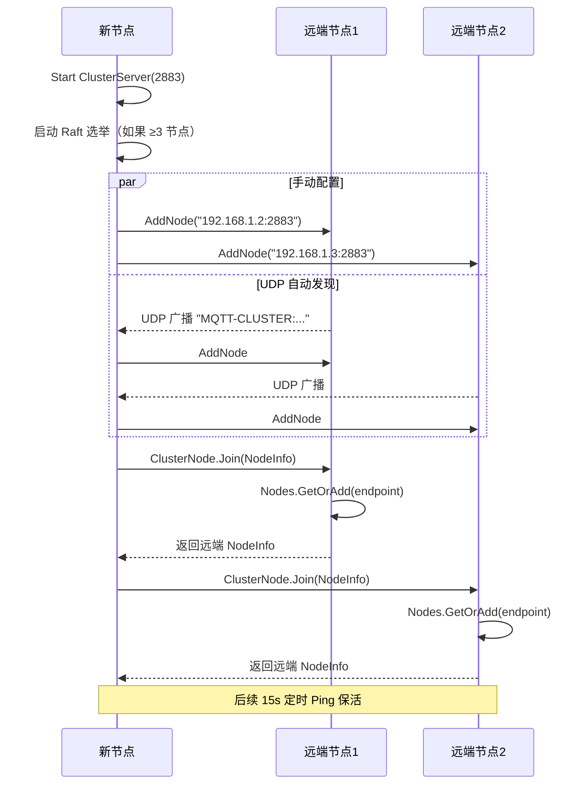
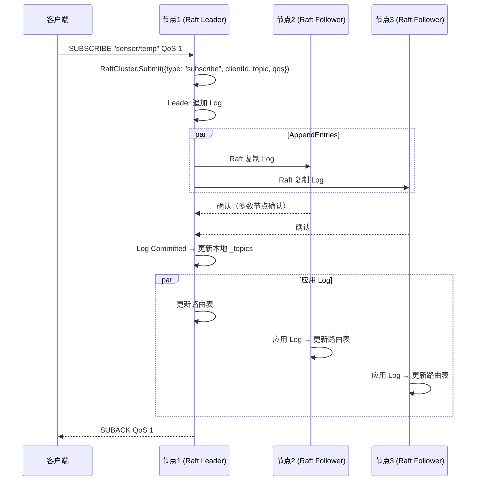
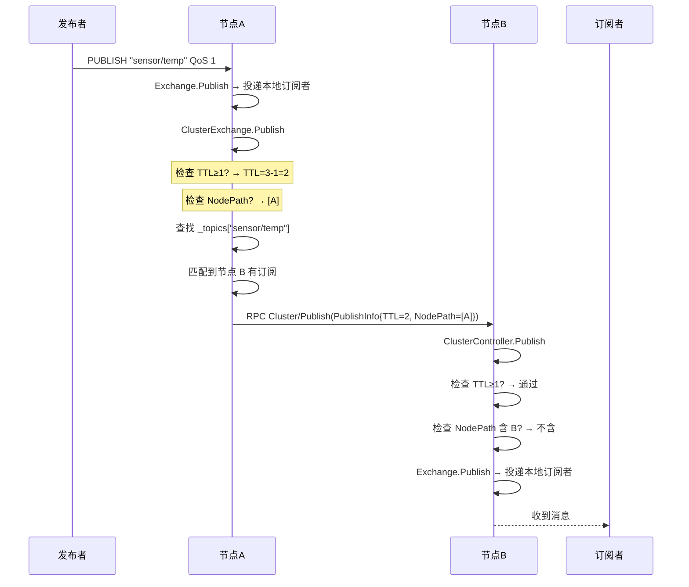
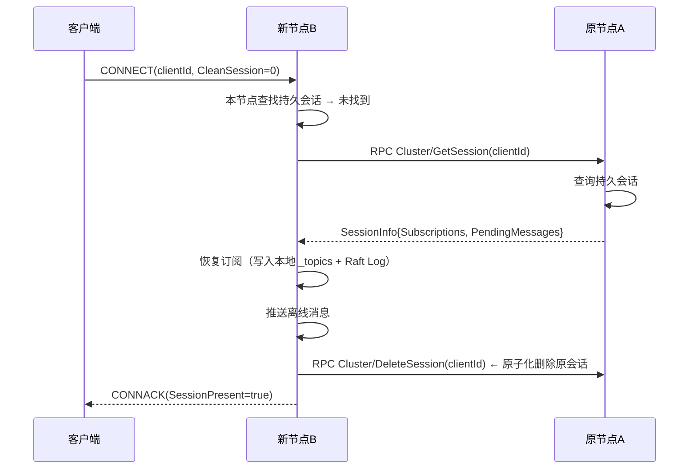
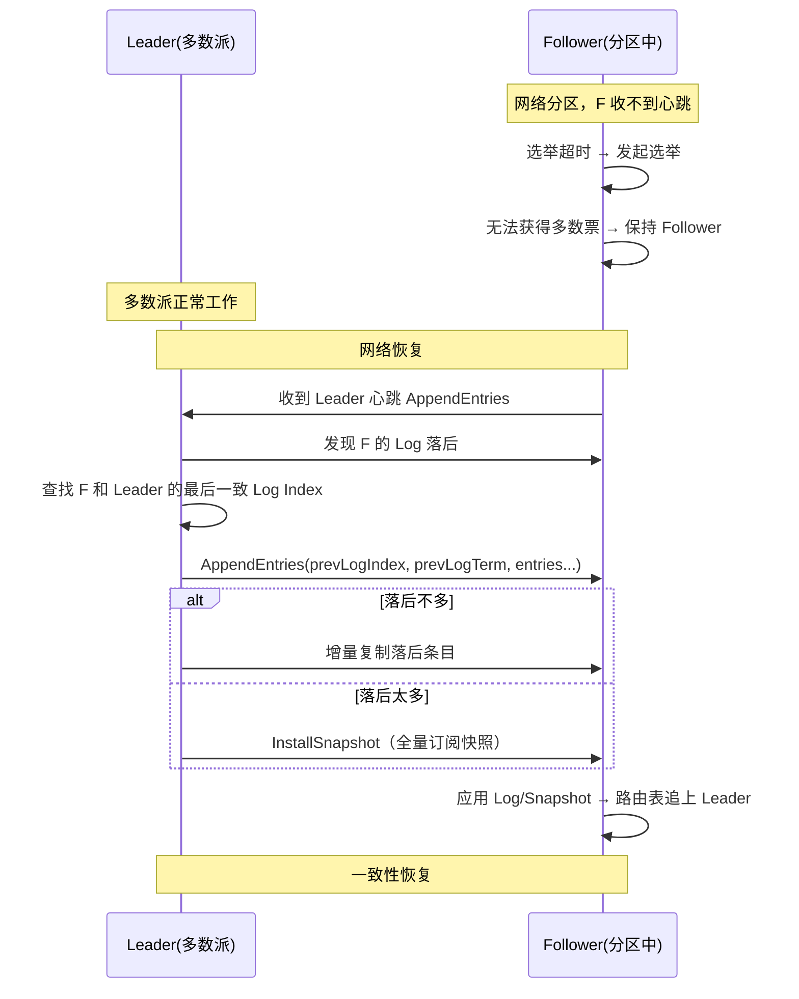

# MQTT 集群架构设计

> 版本：v1.1（区分当前实现与重构规划） | 日期：2026-07-14
> 需求对应：[集群-需求文档](集群-需求文档.md) | 功能清单：[集群-功能清单](集群-功能清单.md) | 返回：[架构设计](架构设计.md)

## 1. 整体架构

### 1.1 当前实现（v3.x 现状）

当前集群是一个 RPC 广播式集群，内置于 `NewLife.MQTT/Clusters/` 目录：

```
  Node A ──RPC──► Node B     通信方式：ApiServer/ApiClient（独立端口 2883）
    │               │         订阅同步：RPC 广播（foreach 遍历）
    └───RPC──► Node C        消息转发：主题过滤器匹配后 RPC 转发
                             节点发现：UDP 广播 (ClusterDiscovery)
```

**当前已实现（代码中真实存在）**：`ClusterServer.cs`、`ClusterNode.cs`、`ClusterController.cs`、`ClusterExchange.cs`、`ClusterDiscovery.cs` 及 4 个数据模型。

### 1.2 重构后目标架构

新增 Raft 共识（订阅强一致）+ 环路检测 + 共享密钥：

```
              Raft Group（订阅关系强一致）
             ┌──────────────────────────┐
             │ Leader ── Log ──► Node 2 │
             │   └────── Log ──► Node 3 │
             └──────────────────────────┘
                        │
            消息转发走直连（最终一致）
           Node 1 ◄──────► Node 2
             └──────────────► Node 3
```

**重构后需新增（🔧 = 规划中，代码暂不存在）**：
- 🔧 `Clusters/RaftCluster.cs` — Raft 共识引擎
- 🔧 `Clusters/GossipExchange.cs` — Gossip 可选模式

**重构后需修改**：`ClusterExchange.cs`（Raft Log + 环路检测）、`ClusterController.cs`（ClusterSecret）、`PublishInfo.cs`（TTL+NodePath）

### 1.3 项目结构

```
NewLife.MQTT/                  # 核心库（集群内置，零额外依赖）
  └── Clusters/                # 全部集群代码
       ├── ClusterServer.cs       # ✅ 已实现
       ├── ClusterNode.cs         # ✅ 已实现
       ├── ClusterController.cs   # ✅ 已实现
       ├── ClusterExchange.cs     # ✅ 已实现
       ├── ClusterDiscovery.cs    # ✅ 已实现
       ├── RaftCluster.cs         # 🔧 重构新增
       ├── GossipExchange.cs      # 🔧 重构新增（可选）
       └── ...

NewLife.MQTT.Storage/          # 🔧 新项目（持久化扩展）
  依赖: NewLife.MQTT + NewLife.XCode + NewLife.Redis
```

### 1.4 分层职责

| 层次 | 组件 | 状态 | 职责 |
|------|------|:----:|------|
| **共识层** | `RaftCluster` | 🔧 | 订阅元数据的 Raft 共识（Leader 选举、Log 复制、Snapshot） |
| **传播层** | `GossipExchange` | 🔧 | 节点间 Gossip 传播（可选，大规模场景） |
| **管理层** | `ClusterServer` / `ClusterNode` | ✅ | 节点 Join/Ping/Leave、超时剔除 |
| **发现层** | `ClusterDiscovery` | ✅ | UDP 广播 / SPI 自动发现 |
| **路由层** | `ClusterExchange` | ✅ | 订阅关系映射 + 跨节点消息转发 |
| **存储层** | `MqttStorageExchange` | 🔧 | Redis / XCode 持久化（Storage 项目） |

### 1.5 依赖关系

```
MqttServer
  └── ClusterServer
        ├── RaftCluster          ← Raft 共识引擎
        ├── ClusterExchange      ← 路由转发（持有 _topics 字典）
        ├── ClusterNode[]        ← 节点连接池
        ├── ClusterController    ← RPC 处理
        └── ClusterDiscovery     ← 自动发现
              └── IClusterDiscoveryProvider  ← SPI
```

---

## 2. 核心组件设计

### 2.1 RaftCluster — Raft 共识引擎 🔧（重构规划中，代码暂不存在）

| 属性 | 说明 |
|------|------|
| 所在工程 | `NewLife.MQTT` |
| 文件名 | `Clusters/RaftCluster.cs`（🔧 待创建） |
| 职责 | 管理 Raft 节点状态机、Leader 选举、Log 复制、Snapshot |

**关键设计决策：**

| 决策 | 选择 | 理由 |
|------|------|------|
| Raft 范围 | 仅订阅元数据 | 消息不过 Leader 保吞吐 |
| Log 条目 | 订阅变更日志（Subscribe/Unsubscribe） | 低频、语义明确 |
| Snapshot | 全量订阅快照 | 节点重启快速恢复 |
| 选举超时 | 150~300ms 随机 | 避免选举分裂 |
| 最小节点 | 3（Raft）/ 1（降级） | Raft 需多数派 |

### 2.2 ClusterExchange — 集群交换机 ✅（当前已实现）

| 属性 | 说明 |
|------|------|
| 所在工程 | `NewLife.MQTT` |
│  文件名 | `Clusters/ClusterExchange.cs`（✅ 已存在） |
│  职责 | 维护远程订阅关系 `_topics` 字典、跨节点消息转发（重构后增加环路检测） |

**`_topics` 字典结构：**

```
ConcurrentDictionary<String, List<SubscriptionInfo>>
  Key:    TopicFilter (如 "sensor/+/temp")
  Value:  List<SubscriptionInfo>
            ├── Endpoint       → 节点地址
            ├── ClientId       → 客户端标识
            ├── Topic          → 原始主题过滤器
            ├── RemoteEndpoint → 客户端远程地址
            ├── SessionId      → 会话标识
            ├── CreateTime     → 创建时间
            └── UpdateTime     → 最后更新时间
```

**消息转发流程：**

```
客户端 PUBLISH → MqttHandler.OnPublish
  1. Exchange.Publish(message)         → 投递本地订阅者
  2. ClusterExchange.Publish(message)  → 跨节点转发
     2a. 检查 TTL（默认 3），超限丢弃
     2b. 检查 NodePath，避免环路
     2c. 遍历 _topics 匹配主题过滤器
     2d. 对匹配的远程节点调用 node.Publish(info)
     2e. 节点不存在则清理残留订阅
```

### 2.3 GossipExchange — Gossip 传播 🔧（重构规划）

| 属性 | 说明 |
|------|------|
| 所在工程 | `NewLife.MQTT` |
| 文件名 | `Clusters/GossipExchange.cs`（🔧 待创建） |
| 职责 | 定期随机选取节点传播订阅增量，降低全连接 N² 压力 |

**工作原理：**

```
每 T 秒（默认 30s）:
  1. 随机选取 2~3 个已知节点
  2. 发送自上次 Gossip 以来的订阅增量（新增/删除）
  3. 接收方合并增量到本地 _topics
  4. 接收方继续传播给其随机节点（八卦传播）
```

### 2.4 ClusterServer / ClusterNode — 节点管理 ✅（当前已实现）

| 组件 | 职责 |
|------|------|
| `ClusterServer` | ✅ 已实现：管理 `Nodes` 字典、启动 RPC 服务、心跳定时器 |
| `ClusterNode` | ✅ 已实现：封装与远端节点的 RPC 通信（Join/Ping/Leave/Subscribe/Publish） |

**节点生命周期：**

| 事件 | 触发 | 动作 |
|------|------|------|
| 节点发现 | UDP 广播 / 手动配置 | `AddNode(endpoint)` → 创建 ClusterNode |
| 节点加入 | 节点启动 / Ping 首次 | `Join(info)` → 记录到 Nodes |
| 心跳 | 15s 定时器 | `Ping(info)` → 更新 LastActive |
| 节点离开 | 正常关闭 | `Leave(info)` → `TryRemove` |
| 故障检测 | 5min 无心跳 | 主动 `TryRemove` + 清理订阅 |

### 2.5 ClusterDiscovery — 自动发现 ✅（当前已实现）

| 属性 | 说明 |
|------|------|
| 所在工程 | `NewLife.MQTT` |
| 文件名 | `Clusters/ClusterDiscovery.cs` |
| 职责 | UDP 广播发现同网段节点，支持 SPI 扩展 |

**UDP 广播协议：**
```
公告格式: "MQTT-CLUSTER:{IP}:{Port}" (UTF-8)
广播端口: ClusterPort + 1
公告间隔: 30 秒
```

**SPI 接口（🔧 待定义）：**
```csharp
public interface IClusterDiscoveryProvider
{
    String Name { get; }
    Task StartAsync(ClusterServer cluster, CancellationToken token);
    Task StopAsync(CancellationToken token);
}
```

内置实现：`UdpDiscoveryProvider`（UDP 广播）
扩展实现：`StardustDiscoveryProvider`、`ConsulDiscoveryProvider`（留给用户自行实现）

### 2.6 ClusterSecret — 共享密钥 🔧（重构规划）

**设计理念**：一条密钥同时保护 1883（MQTT）和 2883（集群）两个端口。同一局域网自动信任，跨网段必须验证。不对标 TLS，对标 Erlang Cookie 但更好用。

**配置方式（极简）**：
```csharp
// 局域网部署 —— 零配置，自动发现
services.AddMqttServer(o => o.EnableCluster = true);

// 生产部署 —— 一行密钥
services.AddMqttServer(o => {
    o.EnableCluster = true;
    o.ClusterSecret = "my-production-secret";
});
```

**验证流程**：
```
新节点请求 Join
  → ClusterController 收到请求
  → 提取 ClusterSecret 头
  → 检查：对方 IP 是否同网段？
      → 是，且 UDP 已发现对方 → 允许（局域网信任）
      → 否 → 验证 ClusterSecret
          → 一致 → 允许
          → 不一致/缺失 → 拒绝 + 记日志
```

**竞品对比**：

| | NewLife.MQTT | EMQX | VerneMQ |
|--|:-----------:|:----:|:-------:|
| 方式 | ClusterSecret + LAN 自动信任 | Erlang Cookie（必填） | Erlang Cookie（必填） |
| 局域网免配置 | ✅ | ❌ | ❌ |
| 易用性 | 一行代码 | 需配 Cookie 文件 | 需配 Cookie 文件 |

### 2.7 MqttStorageExchange — 持久化（Storage 项目）🔧
| 文件名 | `MqttStorageExchange.cs` |
| 依赖 | `NewLife.MQTT` + `NewLife.XCode` + `NewLife.Redis` |

**Redis 实现（`RedisExchange`）：**
```
会话 → Hash Key "mqtt:session:{clientId}"
  字段: Subscriptions (JSON), CreatedAt, UpdatedAt
离线消息 → List Key "mqtt:offline:{clientId}"
  元素: JSON 序列化的 PublishMessage
```

**XCode 数据库实现（`DbExchange`）：**
```
MqttSessionEntity      → 表名: MqttSession
  Id(Int64), ClientId(String), Subscriptions(String), 
  CreateTime, UpdateTime, ExpireTime

MqttSubscriptionEntity → 表名: MqttSubscription
  Id(Int64), ClientId(String), TopicFilter(String), 
  QoS(Int32), NodeEndpoint(String), CreateTime

MqttMessageEntity      → 表名: MqttOfflineMessage
  Id(Int64), ClientId(String), Topic(String), 
  Payload(Binary), QoS(Int32), Retain(Boolean), 
  CreateTime
```

---

## 3. 关键流程

### 3.1 节点加入集群



### 3.2 订阅同步（Raft 模式）



### 3.3 消息转发



### 3.4 会话迁移



### 3.5 网络分区恢复



---

## 4. 设计决策

| 决策 | 选项 | 选择 | 理由 |
|------|------|------|------|
| 一致性模型 | 最终一致 / Raft / 混合 | **混合（Raft 元数据 + 最终一致消息）** | 订阅一致防丢消息，消息不过 Leader 防吞吐瓶颈 |
| Raft 范围 | 仅元数据 / 包含消息 | **仅元数据** | 消息过 Leader 会成瓶颈；MQTT QoS 已处理消息语义 |
| 最小节点数 | 2 / 3 / 不限制 | **≥3（Raft 模式）/ ≥1（降级模式）** | Raft 需要多数派；2 节点无法容忍单点故障 |
| 拓扑 | 全连接 / Gossip / 直连+Gossip | **Gossip + 直连混合** | 订阅用 Gossip 减少 N² 连接，消息用直连保持低延迟 |
| 集群位置 | 独立项目 / 核心库 | **核心库内置** | 零依赖承诺不变，集群是内置能力不是扩展 |
| 持久化 | 独立项目 / 核心库 | **独立项目 NewLife.MQTT.Storage** | 可选引入，核心库不增加 XCode/Redis 依赖 |
| 持久化后端 | Redis / XCode / 两者 | **Redis + XCode 双实现** | Redis 高性能、XCode 多数据库支持 |
| 通信安全 | RPC / TLS / ClusterSecret | **ClusterSecret 共享密钥** | 内网无需 TLS；集群密钥 + LAN 自动信任兼顾安全与易用 |
| 环路检测 | TTL / NodePath / 两者 | **TTL + NodePath 双重** | TTL 防无限循环（轻量），NodePath 防短环路（精确） |
| Raft 实现策略 | 引入外部库 / 自研 | **自研精简 Raft** | 保持零外部依赖，自研可精确控制范围 |
| 节点发现 | UDP 广播 / Consul / Stardust | **SPI 接口 + 内置 UDP** | 内置 UDP 开箱即用，SPI 供扩展 |
| 集群端口 | 独立 / 复用 MQTT 端口 | **独立（默认 2883）** | 与 MQTT 客户端连接完全隔离 |

---

## 5. 技术选型

| 领域 | 选型 | 理由 |
|------|------|------|
| 集群 RPC | NewLife.Remoting（ApiServer/ApiClient） | 自有框架，零外部依赖，已在当前集群验证 |
| 共识协议 | 自研精简 Raft（Leader Election + Log Replication + Snapshot） | 零外部依赖；仅需管理订阅元数据，范围可控 |
| Gossip 传播 | 自研 GossipExchange | 简单可靠，定期随机传播 |
| 节点发现 UDP | NewLife.Net UdpClient | 自有，零依赖 |
| Redis 持久化 | NewLife.Redis（FullRedis） | 自有，零第三方依赖 |
| 数据库持久化 | NewLife.XCode（实体 ORM） | 自有，支持 SQLite/MySQL/SQL Server/Oracle |
| 序列化 | NewLife.Core 内置 JSON/Binary | 不引入第三方 JSON 库 |
| 日志追踪 | ILog + ITracer | NewLife.Core 统一接口 |
| 定时器 | TimerX | 高精度，避免 ThreadPool 竞争 |

---

## 6. 验证方案

### 6.1 单元测试

| 测试 | 覆盖 |
|------|------|
| Raft 选举测试 | Leader 选举、选票分裂、任期递增 |
| Raft Log 复制测试 | Log 追加、多数派确认、Committed 状态 |
| Raft 网络分区测试 | 分区期间不可订阅、恢复后自动同步 |
| 环路检测测试 | TTL 耗尽丢弃、NodePath 重复阻止 |
| 订阅同步测试 | 单节点订阅 → 集群可见、退订 → 集群移除 |
| 消息转发测试 | 转发到匹配节点、不转发到不匹配节点 |

### 6.2 集成测试

| 测试 | 覆盖 |
|------|------|
| 3 节点集群 E2E | 客户端连接各节点、跨节点 pub/sub、QoS 0/1/2 |
| 节点加入/离开 | 动态加入、优雅离开、故障剔除 |
| 会话迁移 | CleanSession=0 客户端重连到不同节点 |
| 持久化 Redis | Redis 存储和恢复会话/离线消息 |
| 持久化 XCode | SQLite 存储和恢复会话/离线消息 |
| 网络分区 | 分区期间行为、恢复后一致性 |

### 6.3 编译验证

- 全部目标框架编译通过：net45 / net461 / netstandard2.0 / netstandard2.1 / net6.0 ~ net10.0
- `NewLife.MQTT` 核心库零外部依赖校验
