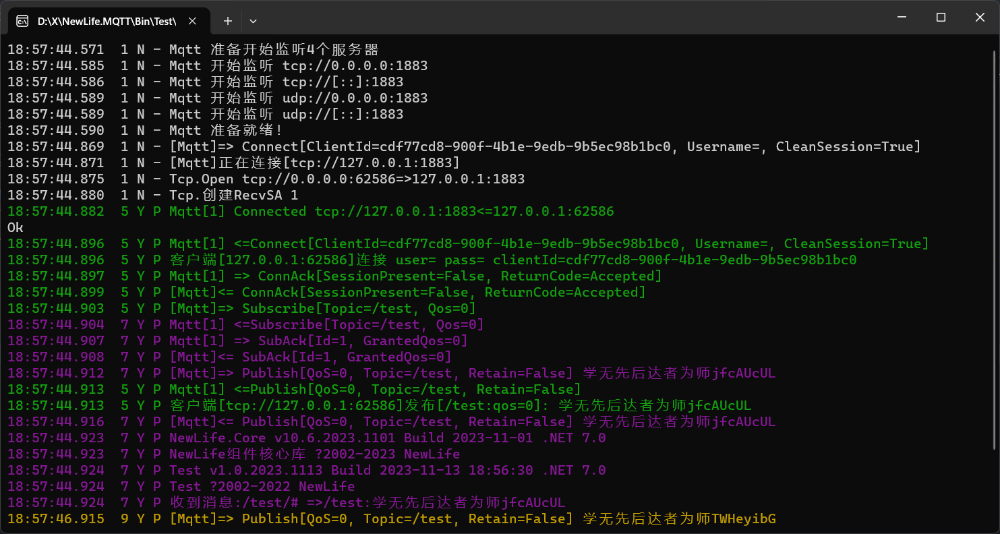

# NewLife.MQTT — 纯国产 MQTT 协议完整实现


[](https://github.com/NewLifeX/NewLife.MQTT/actions/workflows/test.yml)
[](Doc/多语言本地化.md)


[](https://github.com/NewLifeX/NewLife.MQTT/graphs/contributors)

<!-- lang:start -->
🌐 [English](README.md) | [繁體中文](README.zh-TW.md) | [Español](README.es.md) | [Deutsch](README.de.md) | [日本語](README.ja.md) | [Français](README.fr.md) | [Português](README.pt.md) | [Русский](README.ru.md) | [한국어](README.ko.md) | [العربية](README.ar.md)
<!-- lang:end -->

**NewLife.MQTT** 是一款**纯国产自主研发、零第三方依赖、MIT 开源**的 MQTT 完整协议实现，以单一 NuGet 包同时提供功能完整的 `MqttClient` 客户端和高性能 `MqttServer` 服务端（Broker），覆盖 .NET Framework 4.5 至 .NET 10 全部主流运行时。

> ℹ️ 本中文版与 [English README](README.md) 同批维护；若两者内容不一致，以英文版为对外口径。

## 📖 文档导航

| 文档 | 说明 |
|------|------|
| [需求文档](Doc/需求文档.md) | 项目愿景、核心目标、7 大模块功能需求、暂缓与不做什么 |
| [功能清单](Doc/功能清单.md) | 87 个功能点的实现/测试/注释三维追踪状态 |
| [架构设计](Doc/架构设计.md) | 整体五层架构、数据模型、接口设计、关键决策、性能设计 |
| [SRV-服务端架构](Doc/SRV-服务端架构.md) | 服务端 Broker 详细设计：消息路由、安全认证、HTTP 管理 API |
| [CLUS-集群架构](Doc/CLUS-集群架构.md) | 集群四阶段演进路线、Raft 共识、主题分片、多层拓扑 |
| [竞品分析](Doc/竞品分析.md) | MQTT 生态全景对比（EMQX/MQTTnet/Mosquitto 等）、SWOT |
| [CLUS-集群竞品分析](Doc/CLUS-集群竞品分析.md) | 集群能力专项对标（EMQX/HiveMQ/VerneMQ） |
| [集成测试说明](Doc/集成测试说明.md) | 测试架构、运行方法、测试分类、交叉兼容测试（NewLife ↔ MQTTnet，CI 必选） |
| [AOT兼容性分析](Doc/AOT兼容性分析.md) | NativeAOT 实测：主链路 19 场景 JIT/AOT 双跑通过、主流 RID 矩阵（win/linux × x64/arm64 + 龙芯 LA64，CI 见 aot.yml/test.yml）、已实施保根方案、复现方法（冒烟工程 AotSmoke 已入库） |
| [更新日志](Doc/更新日志.md) | 版本发布记录与提交明细 |

---

---

## 核心特性

| 特性 | 说明 |
|------|------|
| **协议完整** | MQTT 3.1 / 3.1.1 / 5.0，14 种基础报文 + AUTH 报文，30 种 5.0 属性 |
| **零依赖** | 仅依赖 NewLife.Core，NuGet 依赖链中无任何第三方包，无供应链安全风险 |
| **客户端+服务端一体** | 单一 `NewLife.MQTT` NuGet 包，无需区分客户端/服务端版本 |
| **七种传输** | TCP / TLS / WebSocket / WSS / QUIC（.NET 7+）/ 可靠 UDP（全平台独创）/ ProxyProtocol v1/v2 |
| **高性能** | 基于 NewLife.Net，单机百万级连接（400 万验证）；Broker 收包实测 **~125 万 msg/s**（多连接），单连接端到端 10.6 万 msg/s；主题路由万级订阅过滤器 120 ns/条恒定（[性能测试报告](Doc/Benchmark/MQTT性能测试.md)）|
| **企业功能免费** | 集群（Raft 共识 / 主题分片）/ 桥接 / 规则引擎 / WebHook / $SYS / ACL 全部免费内置 |
| **自动重订阅** | 断线重连后自动重新订阅全部主题，无需用户代码干预 |
| **SOCKS5 代理** | 内置 SOCKS5 代理支持（用户名密码认证），TCP/WS 连接均可通过代理转发 |
| **全版本覆盖** | net45 / net461 / netstandard2.0 / netstandard2.1 / net6 ~ net10 |
| **NativeAOT 支持** | 主链路 NativeAOT 实测通过（管理 API / 集群 RPC / TCP / WS / 认证 / MQTT-SN 等，19 场景 JIT/AOT 双跑、库侧 0 条 ILC 告警；CI 覆盖 win-x64 / linux-x64 / linux-arm64 / 龙芯 LA64，其中 LA64 AOT 冒烟为观察期不阻断） |
| **信创合规** | 完全自主研发，MIT 开源，无 Copyleft / 专利条款，无境外供应链风险 |

---

## 差异化优势

### MQTT over QUIC（业界罕见）
目前**仅 EMQX 和 NewLife.MQTT 支持**此传输方式：
- 低延迟、无队头阻塞，适合弱网和移动场景
- .NET 7/8 需启用预览特性，.NET 9+ 稳定可用
- 默认端口 14567，ALPN 标识 `"mqtt"`
- 客户端与服务端全链路（连接/订阅/发布/接收）已端到端实测（Linux/libmsquic，`QuicIntegrationTests`）

### MQTT over 可靠 UDP（业界独创）
**全球独创，无需操作系统 msquic 支持，全平台可用**：
- 自研 4 字节帧头 + 序列号 + ACK 确认 + 超时重发
- 覆盖 ARM Linux 4.x 等不支持 msquic 的嵌入式平台

### 断线后自动重订阅
MQTTnet / Eclipse Paho 断线重连后需要用户手动重新订阅，NewLife.MQTT 自动完成：

```csharp
await client.SubscribeAsync("/device/+/data", e =>
    XTrace.WriteLine($"{e.Topic}: {e.Payload.ToStr()}"));
// 重连后无需任何额外代码，订阅自动恢复
```

### 企业功能内置免费
- **消息桥接**：In / Out / Both 三种方向，主题前缀映射，QoS 上限控制
- **规则引擎**：5 种动作（Republish / WebHook / Bridge / Drop / Custom）
- **WebHook**：6 种事件异步推送，失败自动重试，事件集成至 MqttHandler + Exchange 管线
- **集群**：Raft 共识 + 一致哈希主题分片 + 多层拓扑路由，跨节点订阅同步与消息转发，独立 RPC 端口（2883）
- **MQTT-SN v1.2**：受限设备（传感器）接入网关，与 MQTT 主题互通
- **持久化存储**：可选 `NewLife.MQTT.Storage` 扩展包，Redis / 数据库双实现离线消息与会话持久化
- **$SYS 系统主题**：14 种标准主题，实时运行统计
- **ProxyProtocol v1/v2**：nginx/HAProxy 透传真实客户端 IP

---

## 快速开始

### 安装

```bash
dotnet add package NewLife.MQTT
```

### 启动服务端

```csharp
var services = ObjectContainer.Current;
services.AddSingleton<ILog>(XTrace.Log);
services.AddTransient<IMqttHandler, MqttHandler>();
services.AddSingleton<MqttExchange, MqttExchange>();

var server = new MqttServer
{
    Port = 1883,
    ServiceProvider = services.BuildServiceProvider(),
    Log = XTrace.Log,
};
server.Start();
```

### 连接客户端

```csharp
var client = new MqttClient
{
    Log = XTrace.Log,
    Server = "tcp://127.0.0.1:1883",
    ClientId = Guid.NewGuid().ToString(),
};
await client.ConnectAsync();

// 订阅（重连后自动重订阅）
await client.SubscribeAsync("/test/#", e =>
    XTrace.WriteLine($"{e.Topic}: {e.Payload.ToStr()}"));

// 发布
await client.PublishAsync("/test/hello", "Hello MQTT");
```

### 连接字符串初始化

```csharp
var client = new MqttClient();
client.Init("Server=tcp://127.0.0.1:1883;UserName=admin;Password=secret;ClientId=myDevice");
await client.ConnectAsync();
```

---

## 客户端详细用法

### 指定协议版本

```csharp
var client = new MqttClient
{
    Server = "tcp://127.0.0.1:1883",
    ClientId = "myDevice",
    Version = MqttVersion.V500,   // V310 / V311（默认）/ V500
};
```

### QoS 发布

```csharp
await client.PublishAsync("/sensor/temp", "25.6");                                 // QoS 0
await client.PublishAsync("/sensor/temp", "25.6", QualityOfService.AtLeastOnce);  // QoS 1
await client.PublishAsync("/sensor/temp", "25.6", QualityOfService.ExactlyOnce);  // QoS 2
```

### QoS 服务质量说明

发布 QoS 和订阅 QoS 取**较小值**作为消费 QoS：

| QoS | 名称 | 说明 |
|-----|------|------|
| 0 | 至多一次 | 发送后不确认，可能丢失，适合传感器心跳 |
| 1 | 至少一次 | Broker 答复 PUBACK，可能重复，适合重要数据 |
| 2 | 恰好一次 | 四步握手，不丢不重，适合计费/订单 |

### 通配符订阅

```csharp
await client.SubscribeAsync("/device/+/data", handler);   // + 匹配单层
await client.SubscribeAsync("/device/#", handler);        // # 匹配多层
```

### 共享订阅（负载均衡）

格式 `$share/{group}/{topic}`，同组多消费者轮询分发：

```csharp
await client.SubscribeAsync("$share/workers/orders/new", e =>
    XTrace.WriteLine($"收到: {e.Payload.ToStr()}"));
```

### TLS / WebSocket / QUIC

```csharp
new MqttClient { Server = "ssl://broker.example.com:8883" };           // TLS
new MqttClient { Server = "ws://broker.example.com:8083" };            // WebSocket
new MqttClient { Server = "wss://broker.example.com:8084" };           // WSS
new MqttClient { Server = "quic://broker.example.com:14567" };         // QUIC (.NET 7+)
```

> WebSocket 服务端：v12 起由独立 `HttpServer` 承载（`EnableWebSocket = true`，`WebSocketPort` 默认 0 由系统分配、`WebSocketPath` 默认 `/mqtt`），不再与 MQTT 的 TCP 端口共用；客户端仍按 `ws://host:port/mqtt` 连接。设置 `WebSocketCertificate` 后该端口启用 TLS，即 `wss://host:port/mqtt`。

---

## 服务端详细用法

### 自定义处理器

继承 `MqttHandler` 拦截各类消息，适合 IoT 平台直接落库：

```csharp
public class MyHandler : MqttHandler
{
    private readonly ILog _log;

    public MyHandler(ILog log) => _log = log;

    protected override ConnAck OnConnect(ConnectMessage message)
    {
        _log.Info("连接[{0}] user={1} clientId={2}",
            Session.Remote.EndPoint, message.Username, message.ClientId);
        return base.OnConnect(message);
    }

    protected override MqttMessage OnDisconnect(DisconnectMessage message)
    {
        _log.Info("断开[{0}]", Session.Remote);
        return base.OnDisconnect(message);
    }

    protected override MqttIdMessage OnPublish(PublishMessage message)
    {
        _log.Info("[{0} QoS={1}] {2}", message.Topic, (Int32)message.QoS, message.Payload.ToStr());
        return base.OnPublish(message);
    }
}

services.AddTransient<IMqttHandler, MyHandler>();
```

### 自定义认证（ACL）

```csharp
public class MyAuthenticator : IMqttAuthenticator
{
    public Boolean Authenticate(String clientId, String username, String password)
        => username == "admin" && password == "secret";

    public Boolean AuthorizePublish(String clientId, String topic)
        => !topic.StartsWith("$SYS/");

    public Boolean AuthorizeSubscribe(String clientId, String topic) => true;
}

services.AddSingleton<IMqttAuthenticator, MyAuthenticator>();
```

---

## 企业功能

### 消息桥接

```csharp
var bridge = new MqttBridge
{
    Name = "to-cloud",
    Server = "tcp://cloud-broker.example.com:1883",
    Direction = BridgeDirection.Both,
    TopicPrefix = "edge/factory1/",
    MaxQoS = QualityOfService.AtLeastOnce,
};
bridge.Start();
```

### 规则引擎

```csharp
var engine = new MqttRuleEngine();
engine.AddRule(new MqttRule
{
    TopicFilter = "/sensor/+/temperature",
    Action = RuleAction.Republish,
    TargetTopic = "/analytics/temperature",
});
engine.AddRule(new MqttRule
{
    TopicFilter = "/alarm/#",
    Action = RuleAction.WebHook,
    WebHookUrl = "https://api.example.com/alarm",
});
```

### 集群部署

三节点集群配置（每节点配置其他节点地址）：

```csharp
var cluster = new ClusterServer
{
    Nodes = new[] { "192.168.1.11:2883", "192.168.1.12:2883" },
    ClusterPort = 2883,
};
cluster.Start();
services.AddSingleton<IMqttExchange, ClusterExchange>();
```

集群操作：Join 加入（启动时）→ Ping 保活（15 秒）→ Lease 离开（停止时），超时节点（5 分钟）自动剔除。

> v12 起集群 RPC 走 HTTP（`ClusterPort` 为 HTTP 端口，节点地址可写 `host:port` 或 `http://host:port`），共享密钥 `ClusterSecret` 作为请求令牌逐次校验；不再依赖 NewLife.Remoting。

### 阿里云 IoT 适配

```csharp
var client = new AliyunMqttClient
{
    ProductKey = "a1xxxxxxxx",
    DeviceName = "myDevice",
    DeviceSecret = "xxxxxxxx",
};
await client.ConnectAsync();
await client.PublishPropertyAsync(new { temperature = 25.6 });
```

---

## 快速体验

打开源码，将 `Test` 设为启动项目，即同时运行 Server 和 Client：



---

## 核心特点

| 特点 | 说明 |
|------|------|
| 🚀 **协议完整** | MQTT 3.1.1 全面支持（14种报文）+ MQTT 5.0 核心功能完整（30种属性） |
| 🔒 **零依赖** | 仅依赖 NewLife.Core 基础库，无供应链安全风险，无许可证冲突 |
| ⚖️ **MIT 开源** | 最宽松的开源协议，可自由修改商用，无 copyleft 限制，无专利条款，无法律风险 |
| 🎯 **客户端+服务端一体** | 单一 `NewLife.MQTT` NuGet 包同时提供客户端和服务端，极简集成 |
| 🌐 **七种传输协议** | TCP / TLS / WebSocket / WSS / QUIC(.NET 7+) / 可靠UDP / ProxyProtocol v1/v2，业界覆盖面最广 |
| 🏢 **企业功能免费** | 集群/桥接/规则引擎/WebHook/统计/$SYS，竞品需企业版或付费插件 |
| 🇨🇳 **纯国产自主** | 完全自主知识产权，无外部依赖法律风险，信创合规 |
| 🔧 **全版本覆盖** | .NET Framework 4.5 / 4.6.1 / .NET Standard 2.0/2.1 / .NET 7/8/9/10 |

## 差异化优势

### 1. MQTT over QUIC（业界罕见）
- **仅 EMQX 和 NewLife.MQTT 支持**
- 低延迟、无队头阻塞
- .NET 7+ 平台可用（.NET 7/8 需启用预览特性，.NET 9+ 为稳定版本）

### 2. MQTT over 可靠 UDP（独创自研）
- **业界独有**
- 4字节帧头 + 序列号 + Ack确认 + 超时重发
- 无需操作系统 QUIC/msquic 支持，全平台可用

### 3. 企业功能内置免费
- **消息桥接（双向）：** 支持 In/Out/Both 三种方向，主题前缀映射，QoS 上限控制
- **规则引擎（5种动作）：** Republish / WebHook / Bridge / Drop / Custom
- **WebHook 事件推送：** 6种事件，异步非阻塞，支持重试
- **集群支持：** 手动配置节点，跨节点订阅同步与消息转发
- **ProxyProtocol：** 支持 nginx/HAProxy 代理协议 v1/v2，透传真实客户端 IP
- **$SYS 系统主题：** 14种标准主题，实时运行统计

### 4. 重连后自动重订阅
竞品（MQTTnet / Eclipse Paho）断线重连后需要用户**手动重新订阅**，NewLife.MQTT **自动完成**。

### 5. 阿里云 IoT 内置适配
`AliyunMqttClient` 开箱即用，HMAC 签名认证 + 属性上报 + 时钟同步。

## MQTT 协议
最流行的物联网通信协议MQTT，包括客户端、服务端和Web管理平台。  

提供订阅/发布模式，更为简约、轻量，易于使用，针对受限环境（带宽低、网络延迟高、网络通信不稳定），可以简单概括为物联网打造，官方总结特点如下：  
1. 使用发布/订阅消息模式，提供一对多的消息发布，解除应用程序耦合。  
2. 对负载内容屏蔽的消息传输。  
3. 使用 TCP/IP 提供网络连接。  
4. 有三种消息发布服务质量：  
“至多一次”，消息发布完全依赖底层 TCP/IP 网络。会发生消息丢失或重复。这一级别可用于如下情况，环境传感器数据，丢失一次读记录无所谓，因为不久后还会有第二次发送。  
“至少一次”，确保消息到达，但消息重复可能会发生。  
“只有一次”，确保消息到达一次。这一级别可用于如下情况，在计费系统中，消息重复或丢失会导致不正确的结果。  
5. 小型传输，开销很小（固定长度的头部是 2 字节），协议交换最小化，以降低网络流量。  
6. 使用 Last Will 和 Testament 特性通知有关各方客户端异常中断的机制。  

## MQTT 发布与订阅
发布时，指定消息Qos，broker保存的消息包含了Qos；  
订阅时，指定这次订阅要求的Qos，broker回复授权使用的Qos，一般就是申请那个；  
消费时，消息的Qos取发布订阅中较小者！  

详细场景：  
- 订阅Qos=0，不管发布什么消息，消费到的消息Qos都是0；  
- 订阅Qos=1，发布消息Qos=0时，消费得到Qos=0，发布消息Qos=1或2时，消费得到Qos=1；  
- 订阅Qos=2，消费得到的消息Qos，就是发布时的Qos；  
- 发布Qos=0，broker不做任何答复，理论上中途丢了都不知道，但是因为Tcp，如果网络异常客户端能发现；  
- 发布Qos=1，broker答复`PubAck`，表示已经收到消息；  
- 发布Qos=2，broker答复`PubRec`，客户端再次发送`PubRel`，broker答复`PubComp`，消息才算发布完成；
- 订阅Qos=2，broker推送Qos=2消息，客户端先回`PubRec`，broker再次发送`PubRel`，客户端答复`PubComp`，消息才算消费完成；  
- 发布Qos=2消息时，双重确认流程不需要等消费端在线，仅限于发布者与broker之间即可完成。  

## 快速尝鲜
打开源码解决方案，把Test设为启动项目，启动即可。  
默认先后启动TestServer和TestClient。  
  

## 服务端
Nuget引用`NewLife.MQTT`，使用以下代码启动服务端：
```csharp
var services = ObjectContainer.Current;
services.AddSingleton<ILog>(XTrace.Log);
services.AddTransient<IMqttHandler, MqttHandler>();
services.AddSingleton<MqttExchange, MqttExchange>();

var server = new MqttServer
{
    Port = 1883,
    ServiceProvider = services.BuildServiceProvider(),

    Log = XTrace.Log,
    SessionLog = XTrace.Log,
};
server.Start();
```
通过指定端口1883，默认处理器`MqttHandler`，默认交换机`MqttExchange`，启动服务端。  

## 客户端
Nuget引用`NewLife.MQTT`，使用以下代码连接服务端：
```csharp
var client = new MqttClient
{
    Log = XTrace.Log,
    Server = "tcp://127.0.0.1:1883",
    //UserName = "admin",
    //Password = "admin",
    ClientId = Guid.NewGuid() + "",
};

await client.ConnectAsync().ConfigureAwait(false);

// 订阅“/test”主题
var rt = await client.SubscribeAsync("/test", (e) =>
{
    XTrace.WriteLine("收到消息:" + "/test/# =>" + e.Topic + ":" + e.Payload.ToStr());
}).ConfigureAwait(false);

// 每2秒向“/test”主题发布一条消息
while (true)
{
    try
    {
        var msg = "学无先后达者为师" + Rand.NextString(8);
        await client.PublishAsync("/test", msg).ConfigureAwait(false);
    }
    catch (Exception ex)
    {
        XTrace.WriteException(ex);
    }
    await Task.Delay(2000).ConfigureAwait(false);
}
```
客户端连接服务端有几个要素：`服务端地址`、`用户名`、`密码`、`客户端标识`，然后通过`ConnectAsync`连接服务端。  
客户端可以是消费者角色，通过`SubscribeAsync`订阅指定Topic。  
客户端也可以是生产者角色，通过`PublishAsync`发布消息到指定Topic。

## 共享订阅（EMQX）
支持EMQX共享订阅功能，多个客户端可以订阅同一个共享主题，MQTT代理会将消息负载均衡地分发给订阅者。  
共享订阅的格式为：`$share/{group}/{topic}`，其中`{group}`是共享组名，`{topic}`是实际的主题过滤器。

```csharp
// 订阅共享主题，多个客户端订阅同一个共享组，消息会被负载均衡
await client.SubscribeAsync("$share/group1/Yh/Drive/+/OrderLock", (e) =>
{
    XTrace.WriteLine($"收到共享订阅消息: {e.Topic} => {e.Payload.ToStr()}");
}).ConfigureAwait(false);

// 发布消息到实际主题（不包含$share前缀）
await client.PublishAsync("Yh/Drive/1111/OrderLock", "订单锁定").ConfigureAwait(false);
```

共享订阅的优势：
- **负载均衡**：同一共享组内的多个订阅者会均衡接收消息
- **水平扩展**：可以通过增加订阅者来提高消息处理能力
- **高可用性**：某个订阅者故障时， 其他订阅者仍可继续处理消息  

### 指定MQTT协议版本
从2.3.2025.0212版本开始，客户端支持指定MQTT协议版本。可以通过`Version`属性设置协议版本，支持MQTT 3.1、3.1.1和5.0：
```csharp
var client = new MqttClient
{
    Log = XTrace.Log,
    Server = "tcp://127.0.0.1:1883",
    ClientId = Guid.NewGuid() + "",
    Version = MqttVersion.V500, // 指定MQTT 5.0版本
};
```
支持的版本有：
- `MqttVersion.V310` - MQTT 3.1
- `MqttVersion.V311` - MQTT 3.1.1（默认）
- `MqttVersion.V500` - MQTT 5.0

**注意**：如果不显式设置`Version`属性，客户端默认使用MQTT 3.1.1版本，保持向后兼容。

## 自定义服务端
需要在服务端处理客户端连接和消息交互逻辑时，就需要自定义服务端。例如IoT平台，在收到设备上报MQTT数据以后，直接接收落库，而不需要再次消费。  
自定义处理器示例如下：
```csharp
private class MyHandler : MqttHandler
{
    private readonly ILog _log;

    public MyHandler(ILog log) => _log = log;

    protected override ConnAck OnConnect(ConnectMessage message)
    {
        _log.Info("客户端[{0}]连接 user={1} pass={2} clientId={3}", Session.Remote.EndPoint, message.Username, message.Password, message.ClientId);

        return base.OnConnect(message);
    }

    protected override MqttMessage OnDisconnect(DisconnectMessage message)
    {
        _log.Info("客户端[{0}]断开", Session.Remote);

        return base.OnDisconnect(message);
    }

    protected override MqttIdMessage OnPublish(PublishMessage message)
    {
        _log.Info("客户端[{0}]发布[{1}:qos={2}]: {3}", Session.Remote, message.Topic, (Int32)message.QoS, message.Payload.ToStr());

        return base.OnPublish(message);
    }
}
```
稍微修改一下服务端注入处理器的代码即可使用自定义处理器：
```csharp
var services = ObjectContainer.Current;
services.AddSingleton<ILog>(XTrace.Log);
services.AddTransient<IMqttHandler, MyHandler>();
services.AddSingleton<MqttExchange, MqttExchange>();

var server = new MqttServer
{
    Port = 1883,
    ServiceProvider = services.BuildServiceProvider(),

    Log = XTrace.Log,
    SessionLog = XTrace.Log,
};
server.Start();
```

## 集群
集群管理，Join、Ping、Lease。  
Join加入集群，告诉对方我是集群节点之一，启动时调用N-1次。  
每15秒Ping一次所有节点，更新活跃时间。  
Lease离开集群，调用N-1次。  
每个节点根据最后活跃时间，定时剔除超时节点。  

## 生态版图

NewLife 生态按依赖分层，各项目独立版本、独立发版。下面的版图在所有 NewLife 仓库中逐字一致；每个项目链接到代码仓库与主 NuGet 包。

| 项目 | 一句话定位 | 下载量 |
| --- | --- | --- |
| **基础底座** | | |
| [NewLife.Core](https://github.com/NewLifeX/X) | 日志、配置、缓存、网络、序列化、定时调度与 APM 追踪。 | [](https://www.nuget.org/packages/NewLife.Core) |
| [NewLife.XCode](https://github.com/NewLifeX/NewLife.XCode) | 数据中间件：单表百亿级、自动分表、读写分离，支持 10 多种数据库。 | [](https://www.nuget.org/packages/NewLife.XCode) |
| [NewLife.Net](https://github.com/NewLifeX/NewLife.Net) | 高性能网络库：单机 177 万 pps、14.5 Gbps（TCP 1KB，2026-10 实测），400 万 Tcp 长连接。 | [](https://www.nuget.org/packages/NewLife.Net) |
| [NewLife.Remoting](https://github.com/NewLifeX/NewLife.Remoting) | 协议通信与 RPC 框架，面向 CS 应用与物联网设备。 | [](https://www.nuget.org/packages/NewLife.Remoting) |
| [NewLife.Agent](https://github.com/NewLifeX/NewLife.Agent) | 把 .NET 应用安装为操作系统守护进程：Windows 服务与 Linux systemd。 | [](https://www.nuget.org/packages/NewLife.Agent) |
| [NewLife.Templates](https://github.com/NewLifeX/NewLife.Zero) | `dotnet new` 项目模板：控制台、Web、WebApi、服务、数据与物联网。 | [](https://www.nuget.org/packages/NewLife.Templates) |
| **数据存储与消息** | | |
| [NewLife.Redis](https://github.com/NewLifeX/NewLife.Redis) | Redis 客户端：微秒级延迟、百万级吞吐，内置消息队列。 | [](https://www.nuget.org/packages/NewLife.Redis) |
| [NewLife.RocketMQ](https://github.com/NewLifeX/NewLife.RocketMQ) | 纯托管 RocketMQ 客户端，支持 Apache RocketMQ 与阿里云消息队列。 | [](https://www.nuget.org/packages/NewLife.RocketMQ) |
| [NewLife.MQTT](https://github.com/NewLifeX/NewLife.MQTT) | MQTT 客户端与服务端，客户端支持阿里云物联网。 | [](https://www.nuget.org/packages/NewLife.MQTT) |
| [NewLife.NovaDb](https://github.com/NewLifeX/NewLife.NovaDb) | C# 混合数据库：嵌入/网络双模，关系型、时序、消息队列与 KV 于一体。 | [](https://www.nuget.org/packages/NewLife.NovaDb) |
| [NewLife.MySql](https://github.com/NewLifeX/NewLife.MySql) | MySql 驱动与数据访问辅助层，基于 NewLife 数据栈实现。 | [](https://www.nuget.org/packages/NewLife.MySql) |
| **Web、AI 与分布式** | | |
| [NewLife.Cube](https://github.com/NewLifeX/NewLife.Cube) | 魔方快速开发平台：用户权限、SSO、OAuth 服务端与 CRUD 脚手架。 | [](https://www.nuget.org/packages/NewLife.Cube) |
| [Stardust](https://github.com/NewLifeX/Stardust) | 星尘分布式服务平台：节点管理、APM、配置中心、注册中心与发布中心。 | [](https://www.nuget.org/packages/NewLife.Stardust) |
| [AntJob](https://github.com/NewLifeX/AntJob) | 蚂蚁调度：分布式任务与实时数据平台，支持分片、重试与回溯补算。 | [](https://www.nuget.org/packages/NewLife.AntJob) |
| [NewLife.AI](https://github.com/NewLifeX/NewLife.AI) | 统一接入 46 家大模型服务商，附带开箱即用的 ChatAI Web 对话应用。 | [](https://www.nuget.org/packages/NewLife.AI) |
| **工业与物联网** | | |
| [NewLife.IoT](https://github.com/NewLifeX/NewLife.IoT) | IoT 标准库，定义物联网通信协议契约与设备抽象。 | [](https://www.nuget.org/packages/NewLife.IoT) |
| [NewLife.Modbus](https://github.com/NewLifeX/NewLife.Modbus) | Modbus TCP/RTU/ASCII，基于 NewLife.IoT 实现。 | [](https://www.nuget.org/packages/NewLife.Modbus) |
| [NewLife.Siemens](https://github.com/NewLifeX/NewLife.Siemens) | 西门子 PLC 协议，基于 NewLife.IoT 实现。 | [](https://www.nuget.org/packages/NewLife.Siemens) |
| [NewLife.Omron](https://github.com/NewLifeX/NewLife.Omron) | 欧姆龙 PLC 协议，基于 NewLife.IoT 实现。 | [](https://www.nuget.org/packages/NewLife.Omron) |
| [NewLife.Melsec](https://github.com/NewLifeX/NewLife.Melsec) | 三菱 Melsec PLC 协议，基于 NewLife.IoT 实现。 | [](https://www.nuget.org/packages/NewLife.Melsec) |
| [NewLife.OPC](https://github.com/NewLifeX/NewLife.OPC) | OPC 客户端，用于工业数据采集。 | — |
| [NewLife.BACnet](https://github.com/NewLifeX/NewLife.BACnet) | BACnet 楼宇自控协议栈。 | [](https://www.nuget.org/packages/NewLife.BACnet) |
| [ZeroIoT](https://github.com/NewLifeX/ZeroIoT) | 开源轻量级 IoT 平台，含网关与设备管理。 | — |
| **车联网** | | |
| [NewLife.JT808](https://github.com/NewLifeX/NewLife.JT808) | JT/T 808 车辆定位协议：70+ 消息体，覆盖 2011/2013/2019 三个版本。 | [](https://www.nuget.org/packages/NewLife.JT808) |
| [NewLife.JT809](https://github.com/NewLifeX/NewLife.JT809) | JT/T 809 部标平台互联协议，面向运输管理部门。 | [](https://www.nuget.org/packages/NewLife.JT809) |
| [NewLife.JT1078](https://github.com/NewLifeX/NewLife.JT1078) | JT/T 1078 车载视频：RTP 解析、FLV/fMP4 转封装与直播推送。 | [](https://www.nuget.org/packages/NewLife.JT1078) |
| **领域组件** | | |
| [NewLife.Office](https://github.com/NewLifeX/NewLife.Office) | 一个包覆盖 Excel、Word、PPT、PDF 等 15+ 文档格式。 | [](https://www.nuget.org/packages/NewLife.Office) |
| [NewLife.Audio](https://github.com/NewLifeX/NewLife.Audio) | 跨平台音频：编解码、设备 IO、DSP、容器与流式处理。 | [](https://www.nuget.org/packages/NewLife.Audio) |
| [NewLife.Video](https://github.com/NewLifeX/NewLife.Video) | 视频编解码、封装格式、帧处理与流媒体。 | [](https://www.nuget.org/packages/NewLife.Video) |
| [NewLife.Map](https://github.com/NewLifeX/NewLife.Map) | 百度/高德/腾讯/天地图统一接口，支持地理编码与坐标转换。 | [](https://www.nuget.org/packages/NewLife.Map) |
| [NewLife.IP](https://github.com/NewLifeX/NewLife.IP) | IPv4 归属地：离线内存映射库 + 在线 API 双源。 | [](https://www.nuget.org/packages/NewLife.IP) |
| **工具与产品** | | |
| [CrazyCoder](https://github.com/NewLifeX/XCoder) | 码神工具：网络、串口、加解密、正则、Modbus 与 MQTT。 | [](https://www.nuget.org/packages/NewLife.XCoder) |
| [GitCandy](https://github.com/NewLifeX/GitCandy) | 自托管 Git 源代码管理系统。 | — |
| [LuckyClover](https://github.com/NewLifeX/LuckyClover) | 从低版本宿主启动时，自动安装匹配的 .NET 运行时。 | — |

> 徽章取各项目主包；主题包、扩展包与卫星包见对应 NuGet 页面。未在表中列出的 30 多个包（FTP、LoRa、Office 扩展、各类协议驱动等）见 [NewLifeX 组织](https://github.com/NewLifeX) 与 [newlifex.com](https://newlifex.com)。

## 新生命开发团队


新生命团队成立于 2002 年，二十余年专注 .NET 与物联网技术生态，主导开源项目近百个（生态版图收录 34 个主干项目），为电力、物流、医疗、工控、互联网等行业提供软硬件一体化解决方案；以“学无先后达者为师”为信条。

开源组件在 NuGet 累计下载 <!--nuget-total:start-->6.48M<!--nuget-total:end--> 次（全生态口径，截至 2026-10）。

网站：https://newlifex.com · 开源组织：https://github.com/NewLifeX

<details>
<summary>微信公众号：智能大石头（扫码关注）</summary>


</details>
